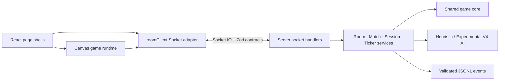

# Tetris Multi

Vite multi-page React·TypeScript UI와 Canvas 게임 엔진, server-authoritative Socket.IO 멀티플레이를 결합한 실시간 Tetris 프로젝트다. 싱글플레이, PVP, 휴리스틱 PVE와 사용자 선택형 placement 모방 AI를 제공한다.

이 프로젝트의 핵심은 기능 수보다 다음 문제를 직접 다룬 데 있다.

- 빠른 조작감과 서버가 소유하는 최종 게임 상태를 함께 유지한다.
- 사람과 AI가 같은 authoritative input·gravity·lock 경로를 사용한다.
- 재접속 중에도 player session과 room 소유권을 검증한다.
- React는 화면과 lifecycle을, Canvas runtime은 게임 실행과 렌더링을 맡는다.
- 마이그레이션 전후의 동작을 자동 테스트와 production artifact로 고정한다.

## 주요 기능

- 배열 기반 Tetris core: 이동, 회전, hold, ghost, line clear, T-Spin, combo, back-to-back
- Single: React HUD와 TypeScript Canvas runtime
- PVP: 방 생성·참가, 채팅, server-authoritative state, garbage, 승패와 재시작
- PVE: 사람과 동일한 authoritative input 경로를 사용하는 휴리스틱 AI
- Experimental PVE: 125게임 placement 선택을 학습한 V4 후보를 명시적으로 선택해 체험
- 연결 복구: session token rotation, reconnect sync, stale input 차단
- 사용자 설정: theme, lobby/game sound
- 분석 데이터: 검증된 placement/game event를 append-only JSONL로 저장

## 핵심 설계



| 문제 | 선택 | 결과 |
| --- | --- | --- |
| 클라이언트만 신뢰하면 보드·공격·승패가 달라질 수 있음 | 서버가 input, gravity, lock, garbage와 game over를 확정 | PVP/PVE의 최종 상태가 하나로 수렴 |
| 모든 snapshot을 즉시 덮으면 조작이 되돌아감 | 내 보드는 prediction 후 correction, 상대 보드는 authoritative snapshot 적용 | 반응성과 일관성을 함께 유지 |
| AI가 좌표를 직접 적용하면 사람과 다른 규칙을 사용함 | AI도 move·rotate·drop input을 순서대로 실행 | 게임 규칙과 로그 의미를 공유 |
| React가 Canvas 내부 상태까지 소유하면 lifecycle이 복잡해짐 | React는 page/HUD, runtime은 state/input/render를 소유 | StrictMode·reconnect cleanup 경계를 분리 |
| 학습 모델이 휴리스틱보다 강하다는 근거가 부족함 | heuristic을 기본값으로 유지하고 V4는 opt-in과 fallback 제공 | 실험 결과를 과장하지 않고 실제 동작만 공개 |

## 기술 스택

| 영역 | 기술 |
| --- | --- |
| Client | React 19, TypeScript, Vite 8 multi-page, Canvas 2D |
| Server | Node.js 24, Express 5, Socket.IO 4 |
| Contract·Security | Zod 4, typed Socket events, CSP, exact Origin validation, rate limiting |
| Game·AI | server-authoritative state, heuristic placement search, experimental pairwise ranker |
| Test | node:test, Playwright, source-less production release tests |
| Delivery | multi-stage Docker, non-root runtime, read-only root, healthcheck, graceful shutdown |

## 실행

Node `24.18.0`은 [.nvmrc](.nvmrc)에 고정되어 있다.

```bash
nvm use
npm ci
```

### 개발 환경

Express/Socket.IO server와 Vite를 각각 실행한다.

```bash
# terminal 1
npm run dev:server

# terminal 2
npm run dev
```

브라우저에서 `http://127.0.0.1:5173`으로 접속한다. Vite는 `/socket.io`를 기본 server인 `http://127.0.0.1:5500`으로 proxy한다.

### Production artifact

```bash
npm run build
NODE_ENV=production \
SOCKET_ALLOWED_ORIGINS=http://127.0.0.1:5500 \
npm start
```

`npm start`는 build를 다시 실행하지 않고 compiled entry인 `dist/server/app.js`를 시작한다. 실제 배포에서는 `SOCKET_ALLOWED_ORIGINS`를 공개 HTTPS origin으로 바꾼다. 배포 artifact에는 first-party TypeScript source와 source map을 포함하지 않는다.

### Docker

```bash
docker build -t tetris-multi:local .

docker run --rm --read-only \
  -p 5500:5500 \
  -e SOCKET_ALLOWED_ORIGINS=http://127.0.0.1:5500 \
  -e GAME_EVENTS_LOG_PATH=/app/data/logs/game-events.jsonl \
  -v tetris-multi-logs:/app/data/logs \
  tetris-multi:local
```

컨테이너는 built-in `node` 사용자로 실행되고 `/app/data/logs`만 영속 volume으로 쓴다.

## 검증

```bash
# whitespace, typecheck, clean build, artifact와 Node 회귀
bash scripts/verify.sh

# production Single/PVP/PVE browser 회귀
npm run test:e2e

# source와 devDependency가 없는 production release
npm run test:release

# Node ↔ Python placement parity (environment-ml.yml의 Conda 환경 필요)
npm run verify:ml
```

`verify:ml`은 [environment-ml.yml](environment-ml.yml)의 `tetris-ml` Conda 환경이 필요하다.

[2026-07-22 Goal 11C 검증 기준](migration-harness/runs/goal-11c-2026-07-22.md):

- Node tests: 594 pass, 기존 조건부 1 skip
- production Playwright: 37/37 pass
- Vite-dev Playwright: 10 pass, production-only 2 skip
- container PVP/PVE: 6/6 pass
- production/full `npm audit`: known vulnerability 0
- Docker: linux/arm64, 약 88 MB, health `starting → healthy`
- SIGTERM: 0.16초, exit code 0

## 보안과 운영 경계

- 신규·재접속 session을 server에서 인증하고 socket generation과 player ownership을 확인한다.
- C2S/S2C payload는 공유 Zod schema에서 검증한다.
- production Socket.IO Origin은 `SOCKET_ALLOWED_ORIGINS` exact allowlist로 제한한다.
- CSP는 기본 enforce이며 필요한 외부 연결만 `CSP_CONNECT_ORIGINS`로 추가한다.
- rate limit과 placement log의 private field 차단·256 KiB 제한을 적용한다.
- production image에는 source, test, dev tool, `.env`와 credential을 넣지 않는다.

## AI 정책

기본 PVE는 휴리스틱 AI다. V4는 Human placement imitation을 확인하기 위한 사용자 선택형 실험 기능이며, 더 강한 gameplay AI나 사용자의 완전한 복제라고 주장하지 않는다. 모델 누락·손상·검증 실패 시 게임을 중단하지 않고 휴리스틱으로 전환한다.

현재 정책과 평가 근거는 [AI/ML 문서 안내](docs/README.md)와 [AI 계획](docs/ai-plan.md)에 정리되어 있다.

## 현재 한계

- room, match, session과 limiter는 단일 Node process memory에 있다.
- 재배포하면 진행 중인 경기는 이어지지 않는다.
- 분석 로그는 단일 instance의 JSONL volume을 사용한다.
- 게임 조작과 레이아웃은 desktop keyboard·Chromium 중심으로 검증했다.
- WebKit/Firefox, 외부 TLS/reverse proxy와 장시간 soak는 아직 검증하지 않았다.
- GitHub Actions CI workflow는 `main`에 반영됐다. PR clean run은 통과했지만, 첫 `main` push에서 기존 PVE T-Spin E2E 1건의 timing flake가 확인돼 main green 복구가 남아 있다.
- branch protection과 공개 배포·CD workflow는 다음 운영 단계다.

Redis·Kubernetes·다중 인스턴스·PostgreSQL 전환은 현재 요구 없이 복잡도만 늘리지 않도록 보류했다. 확장이 실제로 필요해지면 Socket.IO session affinity와 shared adapter, 외부 상태 저장소를 함께 설계해야 한다.

## 문서

- [현재 계획과 검증 상태](PLAN.md)
- [기술 마이그레이션 로드맵](migration-harness/roadmap.md)
- [AI/ML 문서 안내](docs/README.md)
- [게임 로그·데이터셋 정책](docs/game-log-dataset-policy.md)
- [변경 기록](change-log.md)
