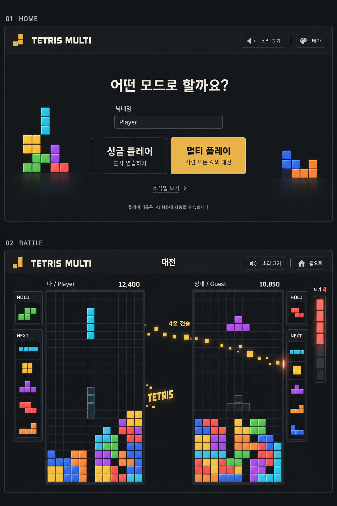

# Tetra Arena 디자인 기획 및 구현 계획

- 작성일: 2026-10-12
- 상태: 1단계 홈 화면과 2A단계 NEXT 4개 확대 구현 완료. 싱글 무입력 진입, 멀티 전용 닉네임 입력, 싱글·PVP·PVE preview를 검증했다.
- 2026-10-12 수정: NEXT 4개 확대, 멀티 전용 닉네임 입력 배치, 기존 React·CSS·Canvas 사용으로 구현 방향 확정.
- 현재 구현 사실과 진행 상태의 기준: `../../PLAN.md`. 이 문서는 디자인 요구와 단계별 완료 기준을 담당한다.
- 성격: 기존 게임의 UI·연출 개선이며 기술 migration Goal을 새로 시작하지 않는다.

## 1. 목적과 성공 기준

범용 서비스 소개 페이지처럼 보이는 홈을 테트리스의 모드 선택 화면으로 바꾸고, 배치·줄 삭제·공격의 결과를 플레이어가 즉시 이해하도록 만든다.

- 홈에서 싱글·멀티 진입은 각각 한 곳만 제공한다.
- 차콜 배경과 골드 강조를 네 페이지에 일관되게 적용한다.
- 게임 중 가장 눈에 띄는 대상은 보드·블록·현재 공격 정보다.
- 내 공격의 전송, 상대의 공격 대기, 실제 쓰레기 줄 적용을 구분한다.
- 기존 게임 규칙, 입력 반응, 서버 권위, AI 및 학습 데이터 의미를 보존한다.

## 2. 승인 시안과 실제 적용 범위



시안은 색감·정보 위계·버튼 통합·공격 전달의 방향을 승인받은 참고 이미지다. 이미지의 모든 세부를 기능 요구로 해석하지 않는다.

- 보드는 실제 10열 × 20행을 유지한다. 이미지의 격자 수는 구현 사양이 아니다.
- NEXT는 현재 2개에서 4개로 확대하는 것을 구현 목표로 변경한다. 이미지에 나온 5개는 적용하지 않는다. 아래 7절의 별도 단계에서 표시·큐·검증을 함께 수정한다.
- 블록 종류·색 구분과 실제 HOLD 규칙은 유지한다.
- 이미지의 광택·그라데이션·반사는 줄이고 단색 면과 얇은 테두리로 구현한다.
- 공격 궤적은 상대 보드를 가로지르지 않고 보드 사이 공간과 외곽을 이용한다.
- 시안에 없는 로비와 싱글에도 같은 색·간격 규칙을 적용하되 기존 기능을 보존한다.

## 3. 시각 디자인 규칙

| 역할 | 다크 테마 기준 | 적용 |
|---|---|---|
| 배경 | `#141618` | 페이지 전체 |
| 패널 | `#1E2124` | 필요한 정보 영역만 |
| 경계선 | `#34383D` | 패널 구분. 입력·포커스는 별도 대비 확인 |
| 주요 글자 | `#F2F0E9` | 제목, 점수, 주요 정보 |
| 보조 글자 | `#A7ADB5` | 설명과 비활성 보조 정보 |
| 강조 | `#E8B44C` | 주요 행동, 공격 전송 |
| 골드 위 글자 | `#141618` | 채워진 주요 버튼 |
| 공격 수신·위험 | `#EF6B63` | 대기 게이지, 피격 반응 |

- 기존 React·CSS·Canvas와 CSS 변수 체계로 구현한다. 이번 계획에는 UI·애니메이션 라이브러리 도입이나 교체를 포함하지 않는다.
- 모서리는 대체로 4~6px, 패널 그림자와 backdrop blur는 최소화한다.
- 블록은 기존 색을 유지하고 UI의 장식 색을 줄여 상대적으로 돋보이게 한다.
- UI 글꼴은 기존 system font 경로를 사용한다. 모든 글자에 픽셀 폰트를 적용하지 않는다.
- 메뉴 명칭은 한국어를 우선하고 HOLD/NEXT 같은 게임 용어는 간결하게 유지한다.
- 골드는 실제 선택·주요 행동에, 붉은색은 수신·위험에 사용한다. 단순 장식에 의미색을 소모하지 않는다.
- 라이트 테마와 저장된 테마 설정을 유지한다. 밝은 배경에서는 골드 글자를 그대로 쓰지 않고 어두운 황토색 강조 등으로 조정한다. 세부 밝은 팔레트는 2B단계에서 실제 대비를 확인해 확정한다.
- 일반 글자 대비 4.5:1, 큰 글자와 필요한 컨트롤 식별 대비 3:1을 검증 목표로 삼는다. 추천 hex만으로 접근성 통과를 선언하지 않는다.

## 4. 페이지별 기획

### 홈

```text
TETRIS MULTI                              소리 · 테마

                어떤 모드로 할까요?

  싱글 플레이                    멀티 플레이
  혼자 연습하기                  사람 또는 AI와 대전
  닉네임 없이 바로 시작          닉네임 (선택) [           ]
                                비우면 Guest로 입장
  [ 바로 시작 ]                  [ 로비 입장 ]

                    조작법 보기
               플레이 기록 사용 안내
```

- 싱글·멀티를 같은 폭의 두 선택 영역으로 구성하고, 실제 이동 동작은 영역별 버튼 한 개에만 둔다. 영역 전체를 또 링크로 만들지 않는다.
- 싱글 링크는 닉네임 form 밖에 두고 바로 게임으로 이동한다. 입력·검증·Guest 생성·닉네임 저장을 거치지 않는다.
- 기존 `enterSingleGame`의 닉네임 저장 부수효과를 제거한다. 이미 저장된 멀티 닉네임을 싱글 진입 시 삭제하지도 않는다.
- 멀티 영역에만 보이는 닉네임 label과 input을 배치한다. 선택 입력이며 빈 값의 Guest 생성, 길이 제한, sessionStorage 전달은 유지한다.
- Enter로 멀티에 진입하는 동작은 멀티 form 안에서만 제공한다. 싱글 링크는 자체 키보드 활성화를 따른다.
- 두 버튼의 폭·높이와 하단 기준선을 맞춘다. 멀티 버튼은 골드, 싱글은 테두리형으로 둔다.
- 좁은 화면에서는 싱글, 멀티 순서로 세로 배치하며 닉네임은 계속 멀티 영역 안에 둔다.
- 기존 아래쪽 `Single / Online` 중복 카드 섹션과 공용 상단 닉네임 form 배치를 대체한다.
- 환영·개발 상태 문구를 정리한다. 데이터 사용 안내의 의미는 유지하고 모드 설명과 분리한다.
- 조작법은 접고 펼칠 수 있게 한다. 키보드 포커스와 펼침 상태를 제공한다.
- 장식 블록은 작고 정적으로 사용한다. 첫 단계에 새 이미지 자산이 필수는 아니다.
- 기존 시안의 공용 닉네임 배치보다 이 수정 레이아웃을 우선한다.

### 로비

- 채팅, 프로필, 방 생성·참가·퇴장, 코드 복사, 시작·대기 상태와 PVE 선택 기능을 유지한다.
- 같은 팔레트와 단순한 패널을 적용한다. 주요 행동과 대기·연결 상태를 구분한다.
- 방·AI 선택은 기존 로비에서 수행한다. 홈에 별도 선택 화면을 추가하지 않는다.
- 기존 실험 AI 정책 안내를 일반 문구 정리 과정에서 삭제하거나 의미를 바꾸지 않는다.

### 싱글

- 보드 중심으로 HOLD·NEXT·점수를 가까이 배치한다.
- 상시 큰 조작법 패널을 줄이고 펼칠 수 있는 보조 안내로 바꾼다.
- 하드 드롭과 줄 삭제 피드백을 적용한다. 공격 전송 UI는 표시하지 않는다.

### 멀티

- 양쪽 보드·플레이어 이름·핵심 수치는 같은 기준선에 정렬한다.
- 대기 공격량은 기존 snapshot의 `pendingGarbageLines`에서 읽으며 숫자와 게이지를 함께 표시한다.
- 게이지는 표시 한도를 두되 한도 초과 시 실제 숫자를 유지한다. 표시 한도는 공격 제한이 아니다.
- 좁은 화면에서 두 보드나 텍스트가 잘리지 않도록 배치를 조정한다. 공간이 부족하면 공격 궤적을 생략하고 숫자와 외곽 반응을 유지한다.
- 별도 모바일 터치 조작은 이번 범위에 포함하지 않는다.

## 5. 타격감 기획

아래 시간은 최초 튜닝값이며 gameplay 지연을 추가하는 요구가 아니다.

| 사건 | 시각 | 소리 | 초기 길이 |
|---|---|---|---|
| 하드 드롭 착지 | 짧은 잔상·착지선, 보드 프레임의 약한 반응 | 짧고 낮은 타격음 | 80~140ms |
| 줄 삭제 | 기존 파편 유지, 줄 수에 따른 강도 구분 | 기존 효과음 기반 차등 | 현재 350ms 유지부터 시작 |
| 공격 전송 성공 | `N줄 전송`과 금색 블록 궤적 | 짧은 발사음 | 180~280ms |
| 공격 대기 수신 | 숫자·게이지 즉시 갱신, 외곽 펄스 | 짧은 수신음 | 100~160ms |
| 쓰레기 줄 실제 적용 | 보드 외곽의 작은 충격 | 수신음보다 묵직한 소리 | 80~140ms |
| T-spin·연속 공격 | 보드 밖 짧은 표시, 제한된 강조 | 강도 구분 | 400~650ms |

- 모든 사건을 같은 강도로 강조하지 않는다. 일반 착지는 작게, 큰 공격은 명확하게 표현한다.
- 서버 상태와 숫자는 즉시 적용한다. 궤적 도착을 기다렸다가 공격량을 적용하지 않는다.
- 전체 화면 점멸과 입력 정지 방식의 hit-stop은 사용하지 않는다.
- 효과 축소 설정을 제공하고 `prefers-reduced-motion`을 기본값에 반영한다. 축소 시 궤적·흔들림을 생략해도 숫자 정보는 남긴다.
- 무음 설정, BGM, 브라우저 오디오 재생 제한을 존중한다. 재생 실패는 게임을 중단하지 않는다.
- 동시에 발생한 효과의 개수와 음량을 제한한다. 소리 자산은 사용권을 확인한 것만 추가한다.
- 새로고침·재접속·재시작·unmount에서 지난 효과를 재생하거나 timer·RAF를 남기지 않는다.

## 6. 상태와 연출의 연결 설계

현재 `presentationEffect`는 `line_clear` 전용이며, shared schema는 strict object다. 여기에 미검증 필드를 임의로 붙여 보내지 않는다.

```text
server placement 결과
  → 상쇄 계산 및 상대 garbage queue 추가 성공 확인
  → 검증된 presentation 데이터 + authoritative snapshot
  → client session이 순서·중복 검사
  → page UI / Canvas / sound가 표시만 수행
```

- 원시 공격량 `rawAttackLines`와 상쇄 후 공격량 `attackLines`를 구분한다. `N줄 전송`은 상대 queue 추가에 성공한 실제 양이다.
- 상쇄와 실제 적용은 각각 `canceledGarbageLines`, `appliedGarbageLines` 등 서버 확정 결과에 근거한다.
- `pendingGarbageLines`의 전후 차이만으로 발사·상쇄·피격 사건을 추측하지 않는다.
- 줄 삭제 없이 쓰레기 줄이 적용될 수 있으므로 모든 전투 효과를 `line_clear`가 있을 때만 보내는 구조로 만들지 않는다.
- 기존 snapshot의 선택적 presentation 확장을 우선 검토한다. 필요한 데이터는 사건 식별자·행위자/대상·실제 전송/상쇄/적용량과 확정 성과 정보로 제한한다. 정확한 DTO는 4단계 계약 테스트와 함께 확정한다.
- 사람 입력, 자연 낙하 ticker, PVE AI의 결과 경로 모두를 포함한다. AI 정책 자체는 변경하지 않는다.
- 한 match/session 안에서 사건을 한 번만 표시한다. 새 match에서 pieceIndex가 초기화되는 경우와 늦은 이전 match 메시지도 검증한다.
- 로컬 예측 하드 드롭 효과와 서버 확정 효과가 두 번 재생되지 않도록 구분한다. 공격 전송은 예측값으로 표시하지 않는다.
- `backToBack`은 현재 의미를 확인하고 성과 문구를 결정한다. flag가 true라는 이유만으로 매번 B2B 보상을 표시하지 않는다.
- React는 HUD·설정·page lifecycle, runtime은 실행 및 연출 수명, renderer는 drawing, server는 판정을 소유한다. 전체 게임 상태를 React에 복제하지 않는다.
- 선택적 필드라도 구버전 strict schema가 거부할 수 있다. 배포 시 client/server 버전 조합을 확인하고 같은 릴리스로 제공한다.

## 7. NEXT 4개 확대

### NEXT: 4개 확대 구현 완료

- 상태: 구현·검증 완료. 싱글, PVP/PVE 양쪽 보드 왼쪽에 네 조각을 세로 한 줄로 표시한다. NEXT 제목은 위에 한 번만 표시하고, 기존 BLOCKS 좌표와 블록 색상을 재사용해 격자 없이 조각 모양만 보여 준다. 서버 bag과 실제 등장 순서는 유지한다.

현재 확인한 연결 지점:

| 지점 | 현재 상태 | 필요한 변경 |
|---|---|---|
| `runtime/tetris.ts` | `NEXT_QUEUE_SIZE = 4`, 앞 네 조각을 display snapshot에 전달 | 완료 |
| `runtime/displayBridge.ts` | snapshot tuple 4개와 네 항목 동등성 비교 | 완료. 네 번째 항목만 바뀌어도 HUD 갱신 |
| `state/pieceQueue.ts` | preview 수를 인자로 받아 부족한 조각 보충 | 기존 로직 유지. 2개/4개 표시에서도 실제 등장 순서가 같음을 테스트 |
| 두 게임 TSX 및 renderer/UI | React map과 DOM preview builder가 요청 개수만큼 구성 | 완료. 각 플레이어의 4×4 preview 4개, 총 64 cell |
| 서버 bag 및 snapshot | snapshot의 queue 배열과 bag chunk를 그대로 전달 | 서버 규칙 변경 없음. bag 경계, PVE와 재접속 E2E 통과 |

- 싱글·내 보드·상대 보드에 동일하게 NEXT 4개를 표시한다. 2/4 선택 옵션은 만들지 않는다.
- 조각 생성 알고리즘과 실제 등장 순서를 바꾸지 않는다. 더 일찍 queue를 채우는 것이므로 동일 seed의 장기 등장 순서와 HOLD 동작을 비교한다.
- bag 부족 때 클라이언트 RNG로 빈 preview를 메우지 않는다. 재접속·snapshot 보정 뒤에도 서버 queue의 앞 네 개를 표시한다.
- `testDisplayBridge.js`, `testTetrisRuntime.js`, `testPieceQueue.js`와 single/multiplayer/PVE/lifecycle E2E의 4개·64 cell 기준을 적용했다. `e2e/helpers/pve.js`도 포함한다.
- `nextQueue`는 placement 로그에도 들어가므로 길이 변화와 dataset/export 소비자를 확인한다. 표시 개수를 늘리기 위해 AI lookahead·feature·학습 설정을 자동 변경하지 않는다.
- 더 많은 정보를 플레이어에게 제공하는 UX 변화이므로 과거 2개 preview 플레이 기록과 비교할 때 조건 차이를 남긴다. DB schema 변경이나 재학습은 이 단계에 포함하지 않는다.

## 8. 단계별 구현 계획

각 단계는 독립적으로 검토·되돌리기 가능한 변경 단위다. 한 단계의 완료 기준을 충족한 후 다음 단계로 진행한다.

| 단계 | 산출물·주요 변경 | 완료 기준 |
|---|---|---|
| 1. 홈 정리 | `pages/index.tsx`, `styles/style.css`: 버튼 통합, 문구, 입력 label, 접이식 조작법, 홈 팔레트와 타이틀·양옆 테트로미노 장식 | 모드별 진입점 1개, 싱글 무입력 진입, 멀티 닉네임·Enter·키보드 이동 검증 |
| 2A. NEXT 확대 | runtime·display bridge·preview·관련 테스트: 2개 → 4개 | 네 개 표시, 순서·HOLD·bag 경계·보정·로그 소비 검증 |
| 2B. 네 화면 시각 통일 | `multiLobby.tsx`, `tetrisSingle.tsx`, `tetrisMulti.tsx`, 두 CSS, 필요한 preview/Canvas 색 연동 | 다크·라이트 모두 읽힘, 10×20 유지 및 NEXT 4개 배치, 로비 기능 보존 |
| 3. 로컬 피드백 | `runtime/tetris.ts`, `runtime/sound.ts`, `render/tetrisRender.ts`, 필요한 HUD·설정 연결 | 하드 드롭·줄 삭제 효과, 무음·축소 옵션, 입력·중력 타이밍 불변 |
| 4. 서버 확정 전투 효과 | 서버 결과/전송 경로, shared 계약, client adapter/session, 멀티 HUD·overlay | PVP·PVE·중력 경로에서 실제 양 표시, 중복·상쇄·재접속 처리 |
| 5. 통합 튜닝·검증 | 레이아웃·효과 시간·음량 보정, 회귀 테스트, PLAN 상태 갱신 | 화면·동작·성능 완료 기준 충족 및 검증 결과 기록 |

1단계에서 공통 `.card` 등을 무차별 수정해 로비까지 바꾸지 않는다. 홈 한정 범위로 시작하고 2B단계에서 공통 규칙을 정리한다.

4단계의 변경 후보와 연결 지점:

- `src/server/services/playerGameplayStep.ts`: 서버 결과 타입과 presentation 원천 확인.
- `src/server/services/matchService.ts`: 사건 식별자와 match 수명 확인.
- `src/server/sockets/multiplayerHandlers.ts`: 사람 입력 뒤 전송 성공 및 snapshot emit.
- `src/server/services/authoritativeTickerService.ts`: 자연 낙하 및 AI 결과 처리·emit.
- `src/server/services/pveAiPlayerService.ts`: 기존 결과 전달 경로 확인, 필요한 경우에만 수정.
- `src/shared/socketContracts.mjs`, `src/shared/socketContractTypes.d.ts`: schema·추론 타입·export 연결 확인.
- `src/client/net/roomClient.ts`: 검증된 payload 전달.
- `src/client/game/entry/multiplayerGameSession.ts`: 중복 방지·로컬/상대 표시 연결·정리.
- `src/client/pages/tetrisMulti.tsx`, renderer/runtime/sound: 효과 표시와 수명 관리.

기존 패턴을 재사용한다. 실제 중복이 확인되지 않은 공통 effect manager, 전역 context, event bus는 만들지 않는다.

## 9. 검증 계획

### 자동 검증

- 런타임·테스트·빌드 동작 변경 후 각 완료 단위에서 `bash scripts/verify.sh`를 실행한다. 현재 스크립트는 diff, typecheck, build, artifact, compiled tests를 검사한다.
- 1단계: `e2e/navigation.spec.js`의 제거될 `[data-multi-lobby-link]` 사용을 실제 남는 멀티 버튼으로 수정한다. 싱글 무입력 진입·멀티 닉네임 전달·Guest·멀티 form Enter·진입점 중복 방지를 함께 확인한다. 싱글 진입 시 저장된 닉네임이 바뀌지 않아야 한다.
- 2A단계: NEXT 4개 및 뒤 두 항목만 변경될 때의 HUD 갱신, 조각 순서, 로그 소비를 확인한다.
- 2B단계: 기존 single/lobby/React lifecycle E2E를 사용해 mount 대상, 포털, 설정과 화면 이동을 확인한다.
- 3단계: 기존 `testTetrisRender.js`, `testTetrisRuntime.js`에 시간 종료·취소·상태 불변·축소 동작 등 필요한 검증을 추가한다. 스타일 값만 복제하는 테스트는 만들지 않는다.
- 4단계: `testSocketContracts.js`, `socketContractTypes.test.ts`, `testMultiplayerSocket.js`, `testAuthoritativeTickerService.js`, `testPveTickerIntegration.js`, `testMultiplayerGameSession.js` 등 해당 경로를 갱신한다. 필드 누락·잘못된 값·중복 사건·상쇄 후 0줄·queue 추가 실패·줄 삭제 없는 피격을 포함한다.
- 최종 브라우저 회귀는 `npm run test:e2e`로 실행한다. 연출 때문에 rollback, game over, 재접속 흐름이 바뀌지 않아야 한다.
- 계약 fixture와 모든 emit/receive 호출자를 함께 검색해 누락을 확인한다.

### 화면 및 체감 검증

- 1600×900, 1280×720, 390×844에서 홈·로비·게임 레이아웃을 확인한다. 좁은 화면에서도 주요 정보가 잘리거나 도달 불가능하지 않아야 한다.
- 다크/라이트, 키보드 포커스, 확대 200%, 효과 축소, 무음을 확인한다.
- 실제 2탭 PVP와 PVE에서 양방향 공격·동시 공격·상쇄·큰 대기량·연속 공격·승패를 확인한다.
- 연출 중 이동·회전·홀드·하드 드롭을 계속 입력해 반응과 상태 동기화를 확인한다.
- 같은 환경에서 변경 전후 frame time과 입력 반응을 비교한다. 효과 수가 늘어도 지속적인 프레임 저하나 메모리 증가가 없어야 한다.
- 떠나기·재시작·재접속을 반복해 잔여 효과·중복 효과음이 없는지 확인한다.
- 수동 체감·성능 측정 없이 타격감 또는 성능 검증 완료로 표시하지 않는다.

## 10. 범위와 완료 보고

이번 범위에서 추가하지 않는 것: 새 프레임워크, 게임 판정·공격 밸런스 변경, AI 재학습, DB/로그 schema 변경, 새 매칭·랭킹·상점·모바일 입력 기능. NEXT 4개는 수정된 구현 목표에 포함한다. UI·애니메이션 라이브러리 도입과 관련 의존성 변경은 이번 계획에서 제외한다.

검증 실패가 있으면 해당 단계는 미완료로 남기고 원인과 미검증 범위를 기록한다. 완료 시 페이지별 전후 화면, 자동 테스트 결과, 수동 대전 확인 결과와 남은 제약을 함께 보여준다. 배포·push·merge는 별도 요청 없이 수행하지 않는다.

참고: [Tetris Effect의 플레이 연동 시청각 방향](https://www.tetriseffect.game/), [반복 점멸 관련 게임 접근성 지침](https://gameaccessibilityguidelines.com/avoid-flickering-images-and-repetitive-patterns/). 시안은 내장 Imagegen으로 생성했으며, 실제 UI는 기존 React/CSS/Canvas로 구현한다.
