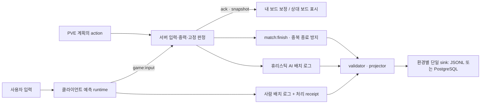

# 게임 오버·버퍼 존 차이 조사와 수정 계획

조사일·피드백 반영일: 2026-10-22 (Asia/Seoul). 기준: `main`, HEAD `3ac6045ff65929efa17561845584eff6fafad174`, 최초 조사 시작 시 tracked/untracked 변경 없음. 이후 계획·fixture·1단계·2단계와 2026-10-23의 3단계를 진행했다. **현재 로컬 구현·검증 상태는 §14를 따른다. §1~11은 최초 조사, §12~13은 이전 checkpoint의 기록이다. 운영 배포는 수행하지 않았다.**

## 1. 왜 함께 수정해야 하는가

현재 게임은 보이는 20행만 저장하고, 조각의 일부가 화면 위에 남은 채 고정되어도 종료한다. 화면 위 공간을 허용하려면 그곳의 블록을 실제로 보존해야 한다. 종료 조건의 `some`을 `every`로 바꾸거나 `BOARD_ROWS`만 40으로 바꾸는 수정으로는 충돌·동기화·표시·로그가 함께 맞지 않는다.

권장 목표는 **보이는 20행 + 숨겨진 20행, 생성 충돌·조각 전체의 상단 고정·버퍼 천장 초과를 구분하는 규칙**이다. 서버가 최종 판정을 소유하고 싱글·멀티 예측·PVE가 같은 core 판정을 사용한다. 전송 계약과 분석 데이터의 의미가 바뀌므로 새 규칙을 식별하고 구버전 탭과 과거 로그를 분리해야 한다.

## 2. 비교 자료와 목표 범위

[2009 Tetris Design Guideline 사본](https://studylib.net/doc/27262492/2009-tetris-design-guideline)의 §10, 인쇄 쪽 26–27은 다음을 구분한다. 일부만 Skyline 위에 걸친 고정은 계속 진행한다. 전체가 위에서 고정되면 Lock Out, 생성 위치가 기존 블록과 겹치면 Block Out, 공격으로 기존 블록이 20행 Buffer Zone의 천장을 넘어가면 Top Out이다. §3.4와 A1.2.1은 숨겨진 영역에서 생성 후 가능할 때 즉시 한 행 내려오는 절차를 설명한다.

[TetrisWiki — Top out](https://tetris.wiki/Top_out)은 partial lock out과 garbage out 등을 별도 분류하고 작품마다 조합이 다르다고 설명한다. 따라서 “모든 실제 테트리스의 단일 규칙”과 비교하지 않는다. 이번 기준은 사용자가 지정한 2009 문서의 게임 오버·생성 규칙이며, 사본이 현재 공식 최신 규정임을 확인한 것은 아니다. 특정 상용 게임을 직접 실행해 비교하지 않았다.

이번 계획은 기존 500ms/15회 고정 유예, 점수·Mini/Full 공격표, garbage 적용 주기, bag을 보존한다. 디자인은 사용자가 제안한 열린 천장과 위로 튀어나오는 조각 표시를 §5.3 범위에서 반영한다. 현재 보상표까지 2009 문서 전체와 동일하다는 뜻은 아니다.

| 상황 | 비교 기준에 따른 목표 | 현재 프로젝트의 확인된 동작 |
| --- | --- | --- |
| 조각 일부만 화면 위에서 고정 | 해당 사실만으로 종료하지 않음 | `isPieceAboveTop`의 `some`으로 종료. 줄 삭제도 생략 |
| 조각 전체가 화면 위에서 고정 | `lock_out` | 일부 고정과 구분 없이 처리 |
| 새 조각의 생성 칸이 겹침 | `block_out` | 구현되어 있으나 생성 좌표와 저장 영역이 다름 |
| 공격으로 블록이 화면 위로 올라감 | 버퍼 안이면 해당 사실만으로 종료하지 않음 | 보드 최상단 행을 밀어내는 즉시 overflow |
| 공격으로 버퍼 천장 밖으로 밀림 | `top_out` | 20행 버퍼 자체가 없어 별도 판정 불가 |
| 생성 직후 한 행 아래가 막힘 | 원래 생성 위치에서 조작 가능 | 내려온 위치에 해당하는 좌표에서 검사해 일찍 block-out할 수 있음 |

위 목표는 각 조건 자체의 판정이다. 부분 고정을 통과해도 이어지는 next spawn이 막히면 같은 턴에 Block Out으로 종료할 수 있다.

## 3. 현재 코드와 재현

### 3.1 판정과 실행 순서

- [core/board.ts](../../src/client/game/core/board.ts): 음수 row를 항상 빈칸으로 취급한다. `lockPieceOnBoard`는 음수 cell을 버리고 `isPieceAboveTop`은 하나라도 음수면 true다. 저장되는 숨은 행이나 유한한 위쪽 충돌 경계가 없다.
- [state/config.ts](../../src/client/game/state/config.ts): `BOARD_ROWS=20`, 공통 spawn `row=-1, col=3`. [blocks.ts](../../src/client/game/state/blocks.ts)의 실제 offset을 합하면 T/J/L/S/Z와 O는 -1/0행, I는 0행에 생성된다. O는 현재 0-based 열 3/4에 있어 중앙 4/5보다 왼쪽이다.
- [matchService.ts](../../src/server/services/matchService.ts)의 최초 상태는 위 상수와 별도로 20행·-1행·3열을 갖는다. 후속 spawn/hold만 바꾸면 첫 조각이 다른 규칙을 쓰게 된다.
- [runtime/tetris.ts](../../src/client/game/runtime/tetris.ts)의 `seizeBlock → handlePostLockFlow`: 고정 전 상단 여부를 계산하고, 고정 후 true면 줄 삭제 없이 종료한다. 싱글과 멀티 내 보드 예측이 이 runtime을 공유한다.
- [playerGameplayStep.ts](../../src/server/services/playerGameplayStep.ts)의 `lockPieceAndSpawnNext`: 상단 판정 → 고정 → 종료 대상이면 줄 삭제/보상 생략 → 공격 상쇄·잔여 garbage 적용 → 종료 또는 next spawn이다. next/hold의 생성 충돌은 `block_out`으로 구분한다.
- [core/garbage.ts](../../src/client/game/core/garbage.ts): 행을 `shift`하면서 버려진 행에 블록이 있으면 overflow다. 현재 저장 행이 곧 표시 행이므로 Skyline을 넘는 것이 천장 초과처럼 처리된다.
- 상단 고정과 garbage overflow 경로는 `gameOverReason`을 별도로 지정하지 않는다. [authoritativeMatchFinish.ts](../../src/server/services/authoritativeMatchFinish.ts)의 기본값 `top_out`으로 모인다. 지금 저장된 `top_out`을 나중에 `lock_out`과 정확하게 분해할 수는 없다.

### 3.2 최소 재현 입력과 관찰

아래 row/col은 **현재 20행 보드 좌표**다. 인위적으로 만든 fixture이며 실제 사용자 기록을 수정하지 않았다.

| 재현 | 실제 관찰 | 수정 후 검사할 결과 |
| --- | --- | --- |
| O를 `row=-1,col=0`에 두고 row 0의 열 2–9, row 1의 열 0/1을 채운 뒤 hard drop | 서버와 simulation 모두 `gameOver=true`, `linesCleared=0`. 완성된 row 0이 남고 O의 위쪽 두 cell은 사라짐 | 대응 좌표에서 부분 고정을 허용하고 줄 삭제. 숨겨진 두 cell도 낙하 후 보존. next spawn 별도 검사 |
| `board[0][0]`만 채우고 garbage 1줄 적용 | `overflow=true`, 기존 cell 소실 | 새 board의 visible row 20이 hidden row 19로 이동. 천장 초과 아님 |
| `board[0][4]`를 채우고 T의 기본 생성 위치 검사 | 현재 row -1은 충돌, row -2는 생성 가능하지만 한 행 하강 불가 | 초기 위치의 겹침과 생성 후 하강 실패를 구분 |
| `boardSchema.safeParse(40×10 board)` | 거부 | 새 계약의 40×10은 승인, 잘못된 크기·cell은 거부 |
| 위 부분 고정을 `canPlacePlacement`에 전달 | false | 새 저장 범위 안의 합법적인 부분 고정을 AI도 후보로 고려 |
| 유효한 종료 로그의 reason만 `lock_out`으로 교체 | canonical projector가 `GAME_EVENT_PROJECTION_INVALID`로 거부 | 새 사유를 생성·검증·투영·저장·읽기까지 보존 |
| 같은 board/pieceIndex에서 server=`playing`, local=`gameOver`를 보정기에 전달 | `shouldCorrect=false` | 서버가 살아 있음을 확정한 경우 로컬의 잘못된 종료에서 복구 |

마지막 항목은 순수 보정 함수로 확인한 경계다. 현재 브라우저에서 이 조건에 도달하는 빈도나 새 규칙 적용 후 실제 발생률은 측정하지 않았다.

## 4. 서버·클라이언트·로그의 책임

“서버 예측”은 이 프로젝트에서는 **서버 확정 실행**으로 구분해야 한다. 서버가 클라이언트 결과를 승패의 원천으로 승인하지 않는다.



- [multiplayerGameSession.ts](../../src/client/game/entry/multiplayerGameSession.ts)는 미확정 입력이 있으면 own snapshot을 보류하고, ack 후 필요한 경우 상태를 교체한다. 일반적인 미확정 입력 재실행 방식의 rollback 엔진은 아니다. 강제 보정은 입력·미확정 로그·연출을 폐기한다.
- [snapshotCorrection.ts](../../src/client/game/runtime/snapshotCorrection.ts)는 서버 종료를 즉시 적용하고, 한 조각 차이는 750ms 유예한다. 같은 board/index의 active 위치 차이는 비교하지 않는다. 새 spawn·숨은 블록의 차이를 위치 비교만으로 잡는다고 가정하면 안 된다.
- garbage의 구멍과 적용은 서버가 소유한다. 클라이언트에는 현재 총 대기 줄 수만 전달한다. 이번 변경에 미래 garbage 구멍 공개나 클라이언트의 독립 garbage 판정을 추가할 필요는 없다.
- [사람 로그 수신부](../../src/server/sockets/multiplayerHandlers.ts)는 receipt로 경기·사용자·조각·sequence를 인증하지만 board와 placementResult 전체를 서버 결과로 치환하지 않는다. [projector](../../src/server/services/gameEventProjector.ts)도 사람 로그를 `client_reported`로 저장한다. receipt는 “이 배치 입력이 처리됨”의 근거이지 전체 로그가 authoritative하다는 증거가 아니다.
- 사람의 `boardAfter`는 로컬 줄 삭제 뒤, 다음 spawn과 서버 garbage 적용 전이다. 서버/PVE 결과는 garbage와 다음 spawn의 종료까지 포함할 수 있다. boolean `gameOver`의 의미와 관찰 시점을 맞추지 않고 학습 label로 합치면 안 된다.
- 싱글 [페이지](../../src/client/pages/tetrisSingle.tsx)는 runtime을 만들 때 서버 로그 recorder를 연결하지 않는다. 싱글의 메모리 로그와 멀티의 DB 저장 경로를 같은 것으로 설명하지 않는다.
- 서버의 human 자연 중력 lock, 종료 직전 늦은 로그, 접속 끊김은 expected placement 수와 실제 저장 수가 다를 수 있는 경계다. receipt의 30초·128건 제한과 기존 누락 탐지 정책을 유지하며 새 규칙의 로그 완전성을 별도로 검사한다.

## 5. 권장 상태·규칙 설계

### 5.1 저장 보드 하나와 표시 영역

권장 표현은 **40×10 배열 하나**, 위에서 아래로 증가하는 절대 row다. 숨은 보드와 보이는 보드를 각각 수정 가능한 상태로 만들지 않는다. 배열에 음수 key를 붙이는 방식은 JSON 직렬화에서 유실되므로 사용하지 않는다.

```text
새 내부 board[0..19]   : 숨겨진 Buffer Zone
Skyline               : 내부 row 19와 20 사이
새 내부 board[20..39]  : 화면의 row 0..19
renderRow             = internalRow - 20
```

`VISIBLE_ROWS=20`, `HIDDEN_ROWS=20`, `TOTAL_ROWS=40`과 Skyline 기준을 공용 config에 둔다. 실제 이름은 기존 export/caller를 확인해 정한다. 충돌·고정·줄 삭제·garbage·로그·wire의 row는 같은 내부 좌표를 쓴다. 가시 게임판은 기존 10×20·300×600 기준을 유지하고, Canvas의 실제 그리기 영역은 열린 천장 표시를 위해 위로 확장한다. 전체 Canvas 높이를 gameplay 행 수로 사용하지 않는다.

기존 보드 위에 빈 20행을 붙이고 piece/선택 cells/유예 lowestRow를 +20한 fixture는 일반 낮은 보드의 동등성을 검사하는 데 사용할 수 있다. **과거 실제 로그에 버퍼가 있었다고 복원하거나 원본을 변환하는 근거는 아니다.**

### 5.2 spawn·lock·garbage 순서

아래는 피드백 검토 후 채택한 프로젝트 규칙이다. 문서에 없는 모든 edge case까지 공식 규칙이라고 단정하지 않는다.

1. 첫 조각·next·hold의 생성 함수를 공통으로 사용한다. 기존 BLOCKS 기준 T/J/L/S/Z/O의 초기 base row는 18, I도 base row 18로 두면 I cell은 19행이다. O만 col 4, 나머지는 col 3이다. 초기 위치가 겹치면 `block_out`; 아니면 가능할 때만 한 행 내린다. 이 초기 이동을 사용자 soft drop 점수나 별도 input으로 기록하지 않는다.
2. 조작 중 숨은 영역의 기존 cell과 충돌한다. cell이 0행 위나 39행 아래로 벗어나면 배치 불가다. piece의 기준점과 실제 cell 범위는 다르므로 padding을 가진 I/O 등의 기준점에 단순 `row >= 0` 검사를 적용하지 않는다.
3. **고정이 확정되는 순간**, 실제 네 cell이 모두 Skyline 위(`cell.row < 20`)인지 판정한다. `lock_out`이면 줄 삭제·공격 상쇄·garbage 적용·다음 spawn 없이 종료하고 terminal placement와 종료 사유를 한 번 기록한다. 버퍼 안에서 이동·회전 중이라는 이유만으로 종료하지 않는다. 마지막 조각의 보드 반영과 기존 드롭 거리 점수는 줄 삭제 보상과 구분해 보존하고 fixture로 검증한다.
4. 일부라도 visible 영역에 있으면 네 cell 전부 저장한다. 줄 삭제는 full board를 기준으로 처리해 숨은 cell도 아래로 내려온다. T-Spin은 기존처럼 고정 전 보드로 분류하며 버퍼 cell의 코너 점유도 반영한다. `classifyTSpin`에서 버퍼 천장 밖(`row < 0`) 코너는 벽/바닥처럼 막힘으로 계산하고, 버퍼 내부(`row 0..19`)는 실제 cell 점유를 사용한다. 전체 상단 고정이면 T-Spin 형태가 성립해도 Lock Out이 우선하므로 줄 삭제·공격 보상은 만들지 않는다.
5. 기존 점수·combo/B2B → outgoing/incoming 상쇄 → 남은 garbage 적용 순서를 유지한다. 40행 전체를 밀어 올릴 때 **버려지는 행에 실제 cell이 있으면** `top_out`이다. visible 영역에서 hidden 영역으로 들어가는 것만으로 종료하지 않는다.
6. 살아 있으면 next spawn의 충돌을 검사한다. 종료 사유는 `lock_out → top_out → block_out`의 실행 순서로 한 번 확정한다. disconnect와 AI 실패는 별도 기존 사유를 유지한다.

전체 상단 고정은 줄 삭제 전 Lock Out으로 확정한다. 현재 서버가 상단 고정에서도 잔여 garbage를 적용하는 흐름까지 함께 수정해야 한다. `some → every` 치환만으로 완료하지 않는다. 살아남는 부분 고정에서는 숨은 영역의 완성 행도 삭제 대상으로 다루되 잠재적인 4줄 초과·기존 완성 행 fixture가 결과 scalar 제한을 깨지 않는지 검사한다.

### 5.3 열린 천장과 표시 좌표

가시 게임판의 윗테두리를 열고 활성 조각이 위로 튀어나와 보이도록 Canvas 그리기 영역을 확장한다. CSS `overflow: visible`만으로는 Canvas bitmap 바깥의 픽셀이 나타나지 않으므로 Canvas 크기·배치·상위 요소의 clipping을 함께 조정한다. 보드 20행의 화면 크기는 유지하고 상단 표시 공간이 HUD·NEXT·상대 보드와 겹치지 않도록 배치한다.

논리 보드 40행, 가시 게임판 20행, 위쪽 표시 영역을 별도로 다룬다. 전체 버퍼 20행을 모두 화면에 표시하는 것은 아니다. 상단 표시 높이는 일반 spawn 조각의 전체 모양을 보여주는 크기를 시작점으로 브라우저·모바일에서 정한다. 그보다 위로 올라가 완전히 잘리는 조각에는 최상단에 열 위치를 알리는 표시를 유지한다. row 19에 닿은 조각만 표시하는 방식으로 제한하지 않는다.

```text
canvasY = upperDisplayHeight + (internalRow - HIDDEN_ROWS) × CELL_SIZE
visibleBoardTop = upperDisplayHeight
canvasHeight = upperDisplayHeight + VISIBLE_ROWS × CELL_SIZE
```

`renderBoardCanvas`의 `rows` 하나로 Canvas 높이와 `board[row]` 순회를 동시에 결정하지 않는다. 고정 cell, 활성 조각, 고스트, 하드드롭의 fromRow/도착 위치, 줄 삭제 row·파편에 같은 좌표 변환을 적용한다. 작은 공용 변환 또는 Canvas transform 중 기존 렌더 흐름에 맞는 최소 구현을 사용한다. 연출·표시 좌표를 게임 상태에 다시 저장하지 않는다.

고스트는 보드 바닥이 아니라 실제 착지 위치에 표시한다. 아래가 막히면 고스트도 버퍼 안에 머물 수 있으므로 고스트만으로 조각 위치를 항상 알 수 있다고 가정하지 않는다. 상단의 실제 cell도 동일한 board를 읽어 표시하고, 고정 블록을 시각적으로 생략하더라도 충돌 상태에서 제거하지 않는다.

## 6. 위험과 대응

P0는 출시 전 반드시 막아야 하는 상태 손상·호환성 문제, P1은 판정·데이터 정확성 문제, P2는 측정이 필요한 성능 문제다.

| 우선도 / 경계 | 현재 근거와 실패 형태 | 계획의 대응·검증 |
| --- | --- | --- |
| P0 / 숨은 상태 | 음수 cell을 버림. 조건만 완화하면 블록 소실 | 40행 단일 원천. 부분 고정→줄 삭제→재접속까지 cell 수·위치 확인 |
| P0 / wire | [socketContracts.mjs](../../src/shared/socketContracts.mjs)는 board 20×10, effect rows 0–19, lockDelay.lowestRow 최대 19. strict object라 필드 추가도 구버전에서 거부 가능 | board/effect/유예와 join·ack·broadcast 계약을 함께 수정. 새·구 조합의 거부/접속 행렬 검증 |
| P0 / 최초·hold spawn | matchService의 최초 spawn 상수가 core와 중복됨 | 세 경로를 공용 생성 규칙에 연결. 전 7종, 특히 O/I와 첫 조각 검사 |
| P0 / 잘못된 예측 종료 | local 종료 후 입력 loop가 멈춤. 같은 board/index면 현재 보정기는 복구하지 않음 | 멀티의 로컬 종료는 확정 승패로 전파하지 않음. 서버 playing 확인 시 phase·입력·유예 복구. 서버 종료는 즉시 확정 |
| P1 / 지연·이전 경기 이벤트 | ack 이전 snapshot 보류, 750ms 유예, gameOver 우선 적용 경계 | 숨은 영역까지 비교. 늦은 ack·중복 finish·이전 match snapshot을 fixture로 검증. 필요하면 snapshot envelope에 기존 gameId를 전달해 경기 경계를 명시 |
| P1 / 서버 동시 실행 | input/ticker/AI가 같은 state에 관여. queue는 player별이며 경기 전체 lock이 아님 | 기존 동기 gameplay와 room 종료 gate 유지. 새 DB await를 사이에 넣지 않음. 동시 탈락 시 기존 첫 확정 정책을 검사하고 무승부 기능은 추가하지 않음 |
| P1 / 종료 로그 | projector FINISH_REASONS에 lock_out 없음. 게임은 끝나도 저장만 실패할 수 있음 | reason 생성·allowlist·canonical payload·finish UI를 함께 검사. 서버 원인과 client 예측 원인을 구분 |
| P0 / 로그 버전 | validator·canonical·SQL 모두 현재 v1/v2만 허용. board 내용은 비교적 자유로워 40행이 구버전으로 잘못 저장될 수도 있음 | 새 로그 v3에서 규칙·크기를 명시적으로 검증. 구버전 읽기는 보존하고 새 의미를 v2에 몰래 넣지 않음 |
| P0 / DB rollback | startup이 migration 최대 버전과 기대값 2의 **정확한 일치**를 요구 | 새 DB 버전을 읽을 수 있는 rollback 빌드 준비. schema 확장 후 과거 이미지만 복구하는 절차 금지 |
| P1 / human 로그 의미 | ack 뒤 저장해도 boardAfter·결과는 client_reported. next block-out/garbage 결과가 다를 수 있음 | v3에 관찰 단계와 규칙 식별을 보존. terminal 승패는 server game_over를 근거로 사용. receipt가 없는 예측 실패 로그는 학습 입력으로 승격하지 않음 |
| P1 / PVE·dataset | [placementGenerator](../../src/client/game/ai/heuristic/placementGenerator.ts)는 모든 cell이 현재 배열 안에 있어야 후보로 인정. simulation은 다음 spawn을 검사하지 않고 heuristic 정렬도 gameOver를 직접 사용하지 않음 | 실제 다음 조각·판정 단계에 맞춘 결과와 생존 후보 우선 정책을 함께 반영. 모델·dataset의 의미 변경을 구분 |
| P1 / UI·T-Spin·유예 | render의 rows가 Canvas 높이와 board 순회를 함께 결정하고 row×cellSize를 직접 사용 | 가시 행·버퍼 offset·상단 표시 높이 분리, 전체 효과 좌표 변환, 천장 코너·유예 회귀 |
| P2 / 크기·처리량 | board cell 수 200→400. 복제·비교·JSON·BFS 후보 수 증가 가능 | payload bytes·동일 룸 수의 tick 지연·후보 생성 시간·DB write 실패를 이전 버전과 비교. 전체 메시지 크기/지연이 정확히 2배라는 주장은 하지 않음 |

### 6.1 wire 변경의 최소 범위

입력의 action, tick, pieceIndex, clientSequence는 유지한다. `expectedTransform`은 현재 type/rotation/col만 포함하므로 row를 추가해 네트워크 지연을 divergence로 오판하게 만들지 않는다. C2S에 최종 board·gameOverReason·숨은 board를 받아 서버 상태를 덮는 기능을 만들지 않는다.

권장안은 새 handshake와 match metadata에 하나의 `gameplayRulesVersion`(예: `buffer20-v1`, 예정 명칭)을 두고 geometry까지 이 버전으로 고정하는 것이다. 서버가 모르는 값이나 누락된 구버전 클라이언트는 기존 오류 전달 형태로 갱신 필요를 알리고 새 경기에 넣지 않는다. 한 경기 안에서 20/40행 규칙을 혼용하거나 재접속 시 자동 변환하지 않는다. 구버전 서버와 새 클라이언트의 조합도 명시적으로 실패하게 한다.

gameId는 기존 경기 UUID를 재사용한다. 새 필드가 실제로 필요한 메시지의 타입·Zod·producer·consumer·fixture만 변경한다. 보정은 board 전체, phase, spinRotation, lockDelay, queue/hold를 복원한다. local gameOver를 해제할 때도 같은 경기의 최신 ack와 해당 예측 입력의 처리 여부를 먼저 확인한다. 오래된 playing snapshot으로 아직 확인되지 않은 종료 예측을 되돌리지 않는다. terminal snapshot도 경기 식별 검사를 통과한 뒤 우선 적용한다. public DTO는 실제 숨은 고정 cell만 추가로 포함하며 session token·내부 pendingPiece·미래 garbage hole을 노출하지 않는다.

line-clear `boardBeforeClear`와 rows도 내부 40행 좌표로 통일하고 renderer에서 visible 부분만 표시한다. 현재 `playLineClearPresentation`의 20행 검사, effect의 최대 행 번호, 보드 픽셀을 읽는 E2E helper를 함께 바꾼다. visible board를 별도의 동기화 원천으로 전송하지 않는다.

### 6.2 로그·DB·과거 데이터

새 raw/canonical 로그는 v3로 구분하고 `gameplayRulesVersion`, geometry, 좌표 의미, 관찰 단계를 payload 안에 보존하는 안을 권장한다. canonical envelope 최상위에 임의 필드를 붙이면 현재 exact-key 계약을 깨므로 payload 투영을 사용한다. geometry와 ruleset은 서버가 확인한 match/receipt 문맥에서 가져와야 한다. 종료 후 match 삭제 뒤 도착하는 사람 로그에도 이 문맥이 필요하므로 짧은 receipt에 필요한 규칙 metadata를 보존한다.

사람 로그의 관찰 단계는 로컬 고정/줄 삭제 직후, 휴리스틱 서버 로그는 garbage/next 검사 뒤라는 차이를 명시한다. 과거 boolean을 전역 승패로 재해석하지 않는다. 서버 확정 board를 별도로 모두 수집하는 대규모 logging 개편은 이번 범위에 추가하지 않는다. v3 terminal 사유를 placement에 넣는다면 [projectPlacementResult](../../src/server/services/gameEventProjector.ts)의 whitelist에도 반영해 조용히 버려지지 않게 한다.

DB에는 새 테이블이나 dual-write 대신 기존 JSONB payload와 **추가 migration**을 사용한다. [002 migration](../../src/server/db/migrations/002_lifecycle_event_v2.sql)을 수정하지 않고 v3 shape를 허용하는 새 migration을 만든다. [canonicalGameEvent.ts](../../src/server/db/canonicalGameEvent.ts), raw validator, projector, import/export, [runtimeEventStorage.ts](../../src/server/services/runtimeEventStorage.ts)의 기대 migration 버전을 함께 맞춘다. app runtime credential에 migration 권한을 추가하지 않는다.

event identity는 현재 placement의 `(gameId, playerId, pieceIndex)`와 lifecycle의 `(gameId, eventType)`를 유지한다. payload/schema 변경은 digest를 바꾸지만 identity에는 schemaVersion이 없으므로, 과거 event를 새 버전으로 다시 보내면 `IDEMPOTENCY_CONFLICT`가 될 수 있다. 기존 DB row·JSONL·event hash를 재작성하지 않고 새 경기 UUID에서 새 버전을 기록한다. 누락된 hidden cell이나 과거 `top_out` 세부 사유는 추정 복구하지 않는다.

저장은 계속 환경별 single-sink다. PostgreSQL pool 4, in-flight 16, 200ms 연결/쿼리 제한, 최대 3시도, 전체 write budget 2700ms와 shutdown drain을 보존한다. 256KiB 이벤트 상한을 무조건 늘리지 않고 새 최대 payload를 측정한다. 거부·실패·누락은 관측해야 하며 DB 지연으로 게임 tick을 기다리게 하거나 JSONL로 조용히 fallback하지 않는다.

## 7. AI·ML 영향과 보존 기준

1. [simulatePlacement.ts](../../src/client/game/ai/heuristic/simulatePlacement.ts)는 현재 partial lock-out을 simulation 결과로 사용한다. [reachablePlacementPlanner.ts](../../src/client/game/ai/heuristic/reachablePlacementPlanner.ts)는 `canPlacePlacement`를 통해 상단 부분 배치를 제외한다. 런타임만 바꾸면 AI가 새로 살아남을 수 있는 배치를 버리거나 `NO_LEGAL_PLACEMENT`로 조기 패배할 수 있다.
2. 새 planner는 40행 충돌 공간과 유한한 천장을 사용하고 Skyline을 별도로 이해해야 한다. 숨은 합법 후보·전체 상단 고정의 terminal 후보·실제 action 실행 결과를 구분한다. action 배열 재생 중 조각이 먼저 고정되면 기존 plan 폐기 규칙을 유지한다.
3. [boardMetrics.ts](../../src/client/game/core/boardMetrics.ts)는 바닥 기준 높이를 계산한다. 빈 20행을 위에 붙이고 기존 블록을 +20 이동한 경우 높이는 유지된다. 모든 높이가 자동으로 +20 증가하는 것은 아니다. 실제 hidden stack이 생기면 높이가 20을 넘고 후보·hole·gameOver 분포가 달라진다.
4. 현재 [feature schema](../../src/client/game/ai/dataset/placementFeatureSchema.ts)는 v1·16개이며 `candidateResult.gameOver`를 포함한다. 열 개수뿐 아니라 의미 변화도 호환성 판단 대상이다. 새 dataset/feature/bundle에 ruleset lineage를 보존하고 의미가 달라진 feature 계약은 새 버전으로 분리한다. 숫자 버전만 바꾸고 기존 model이 읽게 하지 않는다.
5. 기존 V4 모델·checksum·원본 125g 및 다른 canonical 산출물은 그대로 둔다. 새 규칙에서 V4를 요청하면 **명시적인 휴리스틱 fallback**을 사용한다. V4 후보 변환·추론 전에 규칙을 검사하고 기존 fallback 경로에 새 `RULESET_INCOMPATIBLE` 사유를 연결한다. `policyRequested=placement_v4`, `policyUsed=heuristic`과 사유를 기존 metadata·재접속 상태에 보존한다. 현재 배지는 전환 사실만 본문에, 사유는 title에 표시하므로 모바일에서도 읽을 수 있게 `새 규칙 미지원 · 휴리스틱 사용`처럼 짧은 사유를 본문에 표시한다. 실제 heuristic 실행 로그와 V4 출력의 학습 제외 정책을 유지하고 자동 재학습은 시작하지 않는다.
6. 과거 raw 로그를 최신 후보 생성기로 다시 평가하면 같은 입력 파일이어도 dataset이 달라진다. 기존 frozen dataset/bundle은 보존하고, 과거 규칙 재생성이 필요하면 해당 규칙의 고정 commit 도구를 사용한다. 신규 exporter는 규칙이 다른 행을 명시적으로 분리/거부하고 원본은 남긴다. 단순히 20행 로그에 빈 행을 붙여 신규 데이터에 섞지 않는다.
7. 현재 Python parity는 JS가 내보낸 후보·feature bundle의 수치 계산 일치 검증이다. 독립된 Python 테트리스 엔진이 새 top-out 규칙을 검증해 주는 것은 아니다. core↔서버↔브라우저 동일 fixture 검증과 JS↔Python 수치 parity를 분리한다. full gameplay benchmark·재학습은 이 계획으로 자동 승인되지 않는다.

### 7.1 실제 다음 조각의 Block Out과 후보 선택

`simulatePlacement(board, placement)`는 현재 조각 고정·줄 삭제만 수행한다. `rankPlacements → evaluatePlacement → simulatePlacement`의 caller에 실제 nextQueue 문맥을 연결하고 첫 조각/next/hold와 같은 공용 spawn 규칙으로 다음 조각의 생성 충돌을 검사한다. `getHeuristicDecision`에 전달되는 nextQueue는 현재 ranking 호출에 사용되지 않으므로 전달 경로도 수정해야 한다. V4 fallback, human placement 분석, dataset 후보 재생성에도 같은 문맥·관찰 단계를 적용한다.

중앙 사각 영역에 블록이 하나 있다는 이유만으로 `gameOver=true`를 만들지 않는다. 조각별 실제 네 cell과 생성 후 한 행 하강의 의미를 사용한다. next가 없거나 후처리 문맥이 불완전하면 다음 spawn의 종료 여부를 확정하지 않는다. 특히 garbage 적용 전 board에서 검사한 위험을 garbage 적용 뒤의 서버 확정 종료와 같은 결과로 저장하지 않는다. 다음 spawn을 terminal 결과에 포함하는 경로는 서버와 같은 줄 삭제·상쇄·garbage 적용 뒤의 상태와 다음 조각을 알아야 한다. 문맥이 부족한 분석은 현재 단계의 결과로 한정하고 v3 관찰 단계와 함께 구분한다.

현재 heuristic은 gameOver를 반환하지만 score와 정렬에서 직접 사용하지 않는다. 따라서 종료 판정이 가능한 후보끼리는 **확정 즉시 종료를 피하는 후보를 먼저**, 그 안에서 기존 점수·동점 기준으로 정렬한다. 다음 조각을 모르는 경우를 생존 확정으로 승격하거나 모든 종료 후보를 없애서 기존 실패 경로를 바꾸지 않는다. 모든 후보가 종료하는 상황도 정상 종료·로그 경로를 검증한다. 이 의미 변화는 새 dataset/feature 계약에 포함한다.

회귀 fixture는 다음을 포함한다.

- 새 좌표의 `board[18][3]` 점유는 I의 초기 생성에는 충돌하지 않고 J에는 충돌한다. 스폰 구역 전체 점유 검사로 I까지 종료시키지 않는다.
- 부분 고정이 실제 다음 조각을 막는 경우와 줄 삭제로 생성 공간이 다시 열리는 경우를 구분한다.
- 즉시 종료 후보의 기존 점수가 더 높아도 판정 문맥이 같은 생존 후보를 우선한다. next 누락·garbage 전후 문맥 차이는 확정 label로 섞지 않는다.

### 7.2 BFS는 측정 후 최적화

현재 planner는 row 0부터 전수 순회하지 않는다. 활성 조각을 시작으로 이동·회전에 도달 가능한 상태를 BFS하고 각 상태의 hard-drop 위치를 후보로 만든다. 따라서 보드가 40행이 된다는 이유로 `SPAWN_ROW-2` 등의 임의 하한을 추가하지 않는다. 단일 kick의 상승량은 연속 경로의 누적 상승 한도를 증명하지 않으며 높은 stack·hidden 경로를 자를 수 있다.

빈 보드에서 기존 T의 시작 row -1과 새 배열의 대응 row 19를 비교한 임시 검사에서는 최종 후보가 각각 34개로 같았다. 이는 배열 이동의 후보 동등성 확인이며 실행 시간이나 모든 보드의 탐색량 동일성을 증명하지 않는다. 낮은 보드·높은 stack·버퍼 점유·연속 킥 fixture에서 방문 상태 수, 후보 수와 생성 시간을 측정한다. 병목이 확인되면 제한 전후 후보·도달성 동등성을 검증할 수 있는 최소 최적화만 적용한다.

## 8. 실제 수정 범위

파일명은 현재 저장소 기준이다. 아래 묶음 안에서도 실제 caller가 없는 코드를 미리 추상화하지 않는다.

| 작업 묶음 | caller·export·config·fixture까지 포함한 범위 |
| --- | --- |
| 공통 상태·core | `src/client/game/state/{config,blocks,stateFactory,stateSerialization}.ts`, `core/{board,piece,step,garbage,tSpin,lockDelay}.ts`, `src/server/services/gameCoreLoader.ts`. blocks는 모양 변경보다 spawn 좌표 조정으로 해결하는 것을 우선 |
| runtime·렌더 | `src/client/game/runtime/{tetris,snapshotCorrection}.ts`, `src/client/game/render/tetrisRender.ts`, `src/client/game/entry/multiplayerGameSession.ts`, `src/client/styles/tetris.css`, 필요한 `src/client/pages/tetrisSingle.tsx`·`tetrisMulti.tsx` 표시 연결. Canvas 확장·열린 윗테두리·상위 clipping·모바일 배치 포함 |
| 서버 실행·종료 | `src/server/services/{matchService,playerGameplayStep,playerStateInput,authoritativeTickerService,authoritativeMatchFinish,pveAiPlayerService,roomService}.ts`, `src/server/sockets/multiplayerHandlers.ts`. 공용 mutation queue의 기존 실행 보장 유지 |
| 통신·타입 | `src/shared/socketContracts.mjs`, `socketContractTypes.d.ts`, `src/client/net/roomClient.ts`, handshake를 검증하는 `src/server/sockets/index.ts`와 기존 `src/server/services/playerSessionService.ts` 인증 경계, 관련 타입 fixture |
| 로그·DB | `src/client/net/logClient.ts`와 runtime 로그 생성, `src/server/validators/gameLogValidator.ts`, `services/{gameEventProjector,runtimeEventStorage,logService}.ts`, `db/{canonicalGameEvent,importJsonl,migrate}.ts`, 신규 SQL migration, `repositories/postgresEventRepository.ts` readiness 계약 |
| AI·분석 | `src/client/game/ai/heuristic/{placementGenerator,reachablePlacementPlanner,simulatePlacement,heuristicEvaluator,placementLogAnalysis}.ts`, `ai/dataset` builder/schema, `ai/ml` 모델 호환성 경계, `scripts/export-placement-dataset.js`·`export-placement-parity-bundle.js`, 관련 Python reader |
| 검증·배포 산출물 | 아래 테스트, `test-integration/postgresSchemaRepository.js`, `test-artifact/serverBuildArtifact.js`·`productionRelease.js`, `scripts/verify.sh`·DB 검증 명령이 참조하는 migration fixture, 운영 runbook. 빌드 스크립트·패키지는 실제 필요가 생긴 부분만 수정 |

## 9. 구현 순서와 완료 기준

단계는 구현 checkpoint다. 40행 서버와 20행 클라이언트를 각각 운영 배포하는 순서가 아니다.

| 단계 | 수행할 일 | 완료 기준 |
| --- | --- | --- |
| 1. 규칙·fixture 고정 — 완료 | §11에서 채택한 Lock Out·천장 코너·열린 천장·V4 fallback을 fixture로 고정. 실제 next spawn·생존 우선·garbage 경계·v3 관찰 단계를 명시 | §12의 JSON·재현 테스트 23개와 필수 verify 통과. 새 gameplay 구현의 통과를 의미하지 않음 |
| 2. 저장 호환 기반 — 완료 | v1/v2 읽기 유지, v3 validator/projector/canonical/SQL·receipt 문맥·export 분리. DB migration 후에도 구 gameplay를 실행할 수 있는 rollback 빌드 준비 | §13: verify 741 pass·1 skip, 실제 PostgreSQL 9/9, Docker PVP/PVE·재시작 3/3와 v3 저장/backup/restore 통과. gameplay는 아직 이전 규칙 |
| 3. 통합 gameplay 변경 — 완료 | 40행 core·최초/next/hold·runtime·wire·보정·열린 천장 렌더·heuristic의 다음 spawn 평가/선택·V4 fallback을 함께 연결. 새 ruleset의 로그 생성 | 싱글/PVP/PVE에서 같은 fixture가 같은 결과. 내/상대/재접속 hidden 상태 수렴. 기존 유예·T-Spin·전투 회귀 통과 |
| 4. 경계·운영 검증 — 완료 | 지연·재접속·구버전 탭·종료 로그·실제 DB·export smoke·payload/후보 시간 측정 | §15: verify 769 pass·1 skip, Chromium 58/58, PostgreSQL 9/9, Docker 2+1 통과. 배치 수 차이는 명시적인 RATE_LIMITED 수와 일치하며 V4 비호환·export 분리를 확인 |
| 5. 별도 배포 — 완료 | 사용자 요청으로 main CI·운영 backup/restore·호환 rollback을 확인한 뒤 app 교체 | §16: bbf26b7·migration 3 운영 반영, 기존 143,404건 보존, 공개 싱글/PVP/PVE·새 v3 배치 33/33 저장 확인 |

### 필요한 검증 행렬

| 층 | 반드시 확인할 사례 | 기존 테스트 시작점 |
| --- | --- | --- |
| core | 일부/전체 상단 고정, partial+줄 삭제, 숨은 완성 줄, 천장 바로 안/밖, garbage가 빈 행/찬 행을 버림, 7종 생성·하강 실패·hold | `test/testTopOut.js`, `test/testGarbageRules.js`, `test/testMoveStep.js`, `test/testPiece.js`, `test/testTSpin.js` |
| 서버·runtime 동등성 | hard/soft/gravity lock과 499/500ms, hold, 첫 조각, 15/16회 유예, 종료 한 번, score/attack/board/사유 | `test/testPlayerGameplayStep.js`, `test/testTetrisRuntime.js`, `test/testLockDelayIntegration.js`, `test/testAuthoritativeGameplay.js`, `test/testAuthoritativeTickerService.js` |
| wire·보정 | 40행 유효성, hidden만 다른 board, local false gameOver 복구, 지연/중복 ack, 서버 종료 우선, 다른 경기 이벤트, schema 구·신 조합 | `test/testSocketContracts.js`, `test/socketContractTypes.test.ts`, `test/testStateSerialization.js`, `test/testSnapshotCorrection.js`, `test/testMultiplayerGameSession.js`, `test/testMultiplayerSocket.js` |
| DB·로그 | lock_out 포함 모든 종료 사유, v1/v2/v3·신규 geometry, 종료 뒤 지연 receipt, unknown/private 필드 차단, hash/identity 불변, 256KiB·실패·timeout·shutdown | `test/testGameLogValidator.js`, `test/testGameEventProjector.js`, `test/testCanonicalGameEvent.js`, `test/testRuntimeEventStorage.js`, `test/testJsonlImporter.js`, `test-integration/postgresSchemaRepository.js` |
| AI·데이터 | hidden 후보·실제 next 생성 충돌·줄 삭제 후 공간 복구·생존 후보 우선·문맥 누락 구분, BFS 후보 동등성/측정, mixed ruleset 거부, 추론 전 V4 fallback과 학습 로그 정책, export/parity smoke | `test/testPlacementGenerator.js`, `test/testReachablePlacementPlanner.js`, `test/testSimulatePlacement.js`, `test/testHeuristicEvaluator.js`, `test/testPveAiPlayerService.js`, `test/testPlacementDatasetBuilder.js`, `test/testPlacementDatasetExporter.js`, `test/testPlacementParityBundle.js` |
| 실제 브라우저 | 싱글/PVP 두 탭/PVE의 상단 생존·종료·재join·hold·네트워크 복구·새 경기, visible 20행/열린 천장/효과 정렬, 상단 표시 범위 밖 조각과 숨은 ghost, 모바일 겹침/가로 넘침, fallback 사유 본문 표시 | `e2e/singlePlayer.spec.js`, `multiplayerGameOver.spec.js`, `multiplayerRollback.spec.js`, `multiplayerNetworkStall.spec.js`, `lockDelay.spec.js`, `tSpinRejoin.spec.js`, `multiplayerPve.spec.js`, `e2e/helpers/multiplayer.js` |

런타임·테스트·실행 동작을 구현한 checkpoint는 `bash scripts/verify.sh`를 통과해야 한다. 브라우저는 `npm run test:e2e`, DB는 준비된 격리 환경에서 `npm run test:db`와 `npm run test:docker:postgres`를 사용한다. 문서의 명령은 향후 검증 계획이며 이번 조사에서 모두 실행한 결과가 아니다. ML smoke/full 경계는 기존 [ML 안내](../../ai-harness/ml-experiments/README.md)를 따른다.

## 10. 배포와 rollback

[PostgreSQL 운영 runbook](../operations/deployment/postgres-production-runbook.md)의 백업·복구·단일 sink 원칙을 따른다. 실행 중 match는 메모리이므로 배포로 상태를 보존한다고 약속하지 않는다. 진행 중 경기를 마무리하고 새 진입을 제어하는 운영 절차를 먼저 준비한다. 1~4단계는 운영 접속·배포를 수행하지 않았으며, 사용자 요청으로 실행한 5단계 결과는 §16에 기록한다.

권장 순서는 **격리 DB에서 검증 → 백업 → 확장 migration → 동일 버전 server/client → 구버전 탭 갱신 안내 → 새 경기 검증**이다. migration 최대 버전이 3이 되면 조사 기준 HEAD의 서버는 기대값 2와 달라 시작하지 못한다. 2단계에서는 **기존 gameplay + 새 DB 버전 호환 reader/readiness**를 갖춘 빌드를 준비하고 실제 재기동을 검증했다(§13). 새 빌드의 readiness도 검증한 버전 3과 정확히 일치해야 하며 미래 migration을 임의로 `>=` 허용하지 않는다.

rollback은 그 호환 빌드의 server/client를 함께 복구하고 새 경기를 시작한다. 이미 저장된 v3 row·확장 schema·migration 이력·volume은 남긴다. 과거 규칙 reader가 v3를 조용히 v2로 해석하지 않도록 분리한다. 신규 데이터가 있는 DB를 옛 백업으로 덮거나 shape 제약을 v1/v2 전용으로 축소하는 rollback은 사용하지 않는다. 새 규칙의 오류를 이유로 source dataset이나 canonical 산출물을 삭제하지 않는다.

## 11. 이번 조사에서 확인한 것과 남은 것

- 초기 조사에서 Node 기본 shell은 22.18.0이어서 저장소 기준에 맞는 설치된 Node **24.18.0**을 PATH에 지정했다. 그 환경에서 `npm run build:server` 성공. 이번 문서 보완에서 재실행하지 않았다.
- 초기 조사의 `testTopOut`, `testGarbageRules`, `testPlayerGameplayStep`, `testTetrisRuntime`, `testSnapshotCorrection`, `testMultiplayerGameSession`, `testSocketContracts`, `testGameLogValidator`, `testGameEventProjector`, `testCanonicalGameEvent`, `testRuntimeEventStorage`, `testSimulatePlacement`, `testReachablePlacementPlanner`, `testPlacementDatasetBuilder`는 **260개 통과·실패/skip 0**. 새 규칙 구현의 검증 결과가 아니며 이번 문서 보완에서 재실행하지 않았다.
- 별도 임시 assert 실행으로 §3.2의 부분 고정·cell 소실·garbage·생성 위치·40행 wire 거부·AI 후보 제외·lock_out 저장 거부·로컬 종료 보정 경계를 확인했다. 미래 수정의 성공이나 브라우저 종단 재현을 증명한 것은 아니다.
- 변경은 이 계획과 `PLAN.md`, `change-log.md`뿐이다. 피드백 반영 후에도 공백·세 문서의 상대 링크·계획에 명시한 코드 경로·코드 fence 검사를 통과했다. 문서 전용 변경이므로 전체 verify와 브라우저/실제 PostgreSQL/성능/ML full 평가는 실행하지 않았다. 이 문서를 직접 읽는 기존 테스트 계약은 검색에서 찾지 못했다.
- 후속 임시 assert 검사에서 `board[18][3]` 점유 시 I 생성 가능/J 생성 불가, 빈 20/40행 대응 보드의 T 후보 각각 34개를 확인했다. 고스트가 버퍼 안에 머물고 row 19에도 닿지 않는 사례도 확인했다. 실제 브라우저·성능 측정 결과는 아니다. 앞선 코드 경로 64개는 존재 확인 개수이며 모든 파일을 정밀 감사했다는 의미가 아니다.
- 아래 제품 결정을 채택해 §5·§7·단계별 검증에 반영했다. 게임 구현은 별도 작업이며 이 문서 수정으로 시작하지 않는다.

| 결정 | 채택 내용 |
| --- | --- |
| 전체 상단 고정 | 고정 직전 네 cell 모두 row < 20이면 줄 삭제·상쇄·garbage·next 없이 lock_out. 이동 중 버퍼 진입은 종료 아님 |
| 천장 코너 | row < 0은 막힌 코너, 버퍼 내부는 실제 점유. 기존 classifyTSpin에 반영 |
| 표시 | 열린 천장·위로 확장된 Canvas에 실제 조각 표시. 가시 게임판 20행 유지. 표시 범위 밖 조각 위치도 보완하고 ghost만으로 가시성을 보장하지 않음 |
| V4 비호환 | 추론 전에 RULESET_INCOMPATIBLE로 기존 heuristic fallback. 전환 사유를 모바일에서도 읽을 수 있는 배지 본문에 표시 |

- 구현 때 정할 표시 세부값은 상단 영역 높이·잘림 표시의 모양이며, 일반 spawn 가시성과 모바일 겹침/접근성을 기준으로 정한다. BFS 행 제한은 측정과 후보 동등성 근거가 있을 때만 검토한다.
- 이번 문서 변경의 rollback은 새 계획과 PLAN/변경 이력의 해당 항목만 되돌리면 된다. 커밋·push·배포·DB 변경·학습은 수행하지 않았다.

## 12. 1단계: 규칙·fixture 고정 (2026-10-22)

상태: **1단계 완료**. 입력과 목표 결과를 [공용 JSON fixture](../../test/fixtures/top-out-buffer-zone.json)에, 현재 구현과의 차이 재현을 [계약 테스트](../../test/testTopOutBufferContract.js)에 작성했다. 1단계에서는 `src`·실제 socket schema·SQL·model을 변경하지 않았다. 별도 reference 게임 엔진을 테스트 안에 만들지 않고 기존 core를 사용해 관찰 가능한 결과와 목표 데이터를 비교한다.

### 고정한 계약

| 경계 | fixture와 기대 결과 |
| --- | --- |
| geometry·버전 | `gameplayRulesVersion=buffer20-v1`, 40×10·Skyline row 20. fixtureVersion 1은 테스트 데이터 형식이며 새 게임 로그 schemaVersion 3과 별개 |
| lock | `partial-clear`는 부분 고정 후 1줄 삭제·남은 cell 보존. `whole-hidden-before-clear`는 고정 시점 lock_out으로 완성 줄·대기 garbage가 있어도 후처리 생략. terminal cell과 드롭 거리 점수는 보존하고 terminal placement는 1건 |
| spawn | 실제 7종 초기 cell을 명시하고 first/next/hold에 공통 적용. 한 행 하강 실패는 생성 실패가 아님. 같은 row 18/col 3 점유도 I는 생성 가능, J는 block_out |
| 천장·T-Spin | 음수 기준점이라도 실제 cell이 내부에 있으면 배치 가능. 실제 cell이 row < 0이면 불가. 천장 밖 코너는 막힘, 버퍼 빈 코너는 비어 있음, 실제 버퍼 점유는 코너로 계산 |
| next·AI 선택 | partial lock으로 T의 생성이 막히는 경우와 줄 삭제로 다시 열리는 경우를 구분. 동일한 확정 문맥에서는 고득점 종료 후보보다 생존 후보 우선. 전부 종료 후보면 기존 점수 정렬을 유지해 실제 종료 경로로 진행 |
| garbage | visible row 20의 cell을 19로 올리는 것은 생존. buffer row 0의 cell이 밀려나거나 두 번째 적용 줄에서 buffer를 벗어나면 top_out |
| BFS | 빈 보드의 대응 T 후보 각각 34개·좌표 이동 후 후보 동등성. 임의 row 제한은 추가하지 않음. 성능·높은 stack 경로는 후속 측정 |
| 렌더 | 검증용 상단 2행/60px에서 Canvas 300×660, 가시 보드 상단 y=60. row 18/19/20/39는 y=0/30/60/630. 블록·고스트·잔상 시작/도착·줄 삭제에 같은 변환 적용 |
| 표시 예외 | ghost가 row 18에 머물면 가시 게임판에는 없지만 위쪽 영역에 보임. row 16에 머물면 위쪽 표시 영역에도 없으므로 열 위치 표시가 필요. 상단 2행은 좌표 검증용 값이며 최종 모바일 디자인 높이를 고정하지 않음 |
| wire·V4 | 구버전 ruleset 누락/불일치는 경기 전 거부. 40행 V4 요청은 추론 전에 heuristic으로 전환하고 RULESET_INCOMPATIBLE과 본문 사유 표시. 기존 정책 DTO로 사유 전송 가능 |
| v3 관찰 단계 | 좌표는 `internal_top_origin`. `post_line_clear`에서 next 누락 또는 garbage 미해결이면 다음 spawn 결과는 미평가이고 전체 terminal 결과는 미확정. `post_garbage_spawn` 문맥에서만 다음 spawn의 block_out을 확정 |

JSON의 `stage`, `nextSpawnOutcome`, `terminalOutcome`는 이 단계에서 확정/미확정 의미를 표현하는 fixture 용어다. 실제 v3 payload 필드와 union은 2단계에서 validator·canonical·SQL·reader를 함께 맞추며, 현재 boolean을 추정된 false로 채우지 않는다. legacy bytes·hidden cell 누락·사유 누락은 그대로 보존한다.

### 테스트 통과의 의미와 후속 연결

1단계 당시 서버에 40행 배열만 주면 `whole-hidden-before-clear`가 줄 삭제와 garbage를 진행하며, 현재 simulation은 다음 조각을 모르고 현재 heuristic은 gameOver를 직접 정렬하지 않는다. 천장 밖 cell/코너와 wire의 20행 계약도 목표와 다르다. 테스트는 이 **현재 관찰과 목표의 차이를 명시적으로 재현**한다. 테스트 통과를 새 규칙 구현 완료로 해석하지 않는다.

3단계에서는 같은 JSON 입력·목표를 기존 core·서버·runtime·renderer 검사에 연결하고 current/legacy 차이 관찰 assertion을 목표 결과 assertion으로 교체한다. 현재 버그를 보존하는 검사를 영구 요구사항으로 남기지 않는다. 2단계는 규칙 metadata·v3 저장 호환·receipt 문맥·rollback 빌드를 대상으로 하고 gameplay는 이전 규칙을 유지한다.

### 검증 결과와 rollback

- Node 24.18.0으로 `bash scripts/verify.sh` 최종 통과: 공백·typecheck·build·production artifact와 Node **732 pass·기존 조건부 1 skip·실패/todo 0**. 새 계약·재현 검사는 **23개 통과**했다.
- 첫 sandbox 실행은 HTTP 통합 테스트 2개가 `listen EPERM 127.0.0.1`로 실패했다. 코드 assertion 실패가 아니었으며, 로컬 포트를 허용한 실행에서 전체 verify를 다시 실행해 통과했다. 테스트를 생략하거나 기대값을 낮추지 않았다.
- JSON 구문·새 파일 공백·문서 링크·코드 fence를 확인했다. 기존 260개는 초기 조사 기록이며 최종 verify 결과와 구분한다.
- 브라우저·실제 DB·새 gameplay·V4 guard·모바일 디자인·BFS 성능은 이 단계에서 검증하지 않았다. 모델 학습·push·배포는 수행하지 않았고 2단계는 자동으로 시작하지 않는다.
- rollback은 새 fixture/계약 테스트와 §12·PLAN·변경 이력의 1단계 항목만 되돌린다. 앞선 계획/피드백 문서와 사용자 변경, 기존 데이터는 보존한다.

## 13. 2단계: 저장 호환 기반 완료 (2026-10-22)

2단계 완료 당시 상태: **2단계 완료, 3단계 미착수**. 게임은 기존 20행 규칙과 v1/v2 로그 생성을 유지한다. 미래의 40행 v3 로그를 읽고 검증·투영·저장할 경계를 추가했으며 운영 DB에는 접속하거나 migration하지 않았다.

### 구현한 경계

- [규칙 문맥](../../src/shared/gameplayLogContext.ts)은 현재 경기의 `legacy20-v1`과 미래의 `buffer20-v1`을 구분한다. match가 서버 소유 규칙을 갖고 bounded receipt에 식별자를 복사한다. 종료 후 match가 삭제돼도 receipt의 규칙을 확인하며, v3 불일치는 receipt를 소비하지 않고 거부한다. v3 identity·geometry·좌표계는 인증된 문맥에서 설정한다. 현재 match/public snapshot의 게임 규칙·20행 전송 형식은 바꾸지 않았다.
- [v3 검증](../../src/server/validators/gameplayLogV3.ts)을 raw validator와 canonical reader가 공유한다. 40×10·숨은 20행·실제 조각 cell·알려진 cell/type·관찰 단계·terminal 결과를 검사한다. `lock_commit`의 lock_out은 줄 삭제/공격/상쇄/garbage가 0이고 next 미평가여야 한다. human의 `post_line_clear`는 next 미평가/terminal 미확정, heuristic의 `post_garbage_spawn`은 clear/blocked/top_out을 구분한다. boolean gameOver는 이 관찰 단계의 terminal 여부이며 전체 경기 결과를 추정하지 않는다.
- [projector](../../src/server/services/gameEventProjector.ts)는 v3에만 규칙·geometry·관찰 문맥·종료 사유를 allowlist로 보존한다. human은 계속 `client_reported`, heuristic은 `server_authoritative`다. 기존 v1/v2의 whitelist·identity·canonical JSON/hash는 유지하며, 같은 identity의 v2→v3 재전송은 hash가 달라 conflict가 된다. legacy에 없던 hidden cell·분류·사유를 복원하지 않는다.
- [003 migration](../../src/server/db/migrations/003_gameplay_log_v3.sql)은 기존 테이블에 v3 envelope와 필수 규칙/좌표/geometry CHECK를 추가한다. 기존 001/002 SQL은 수정하지 않았다. runtime은 migration 3을 요구하며 pool 4·in-flight 16·200ms 제한·3시도·budget/drain·single-sink를 유지한다. 기존 HEAD 이미지를 migration 3의 DB에 직접 되돌리는 것은 여전히 불가하다.
- [JSONL importer](../../src/server/db/importJsonl.ts)는 v3를 보존하고 완결성을 검사한다. 한 경기의 규칙이 섞이면 불완전으로 분류하고 v3 경기의 `mlExportEligible`은 false다. [기존 exporter](../../scripts/export-placement-dataset.js)는 v3가 포함된 경기의 placement를 `UNSUPPORTED_GAMEPLAY_RULESET`으로 rejected 산출물에 남긴다. 새로운 후보/feature 생성을 20행 엔진으로 수행하지 않는다. 새 v3 dataset 학습·모델 수정은 하지 않았다.

### 검증 결과

| 검사 | 결과 |
| --- | --- |
| 필수 `bash scripts/verify.sh` | Node 24.18.0, 공백·typecheck·build·artifact·**741 pass·기존 Python reference 조건부 1 skip·실패/todo 0** |
| `npm run test:db` | 격리 PostgreSQL 17.10 **9/9**. migration 2→3에서 기존 row/hash/ingested_at 보존, 재실행 0 applied/3 skipped, v3 insert/duplicate/conflict·CHECK·기존 runtime 재기동, source-less production dependency 설치 통과 |
| `npm run test:docker:postgres` | 격리 read-only/non-root 앱·TLS DB, Chromium **PVP/PVE 종료·같은 방 재시작 2/2**, DB 중단 중 PVE **1/1**. v3 저장 후 재시작, backup/restore snapshot 일치. synthetic event 27건·privacy 0·duplicate 0 |
| 종료/저장 한도 | Docker 종료 두 번 모두 exit 0·OOM false·pool 잔여 연결 0. DB 중단 시 bounded retry·실패 보고, JSONL fallback 없음 |
| 기타 | JSON·문서 링크·새 파일 공백·shell 구문 검사. 현재 gameplay가 20행임을 DB 재기동 검사로 확인 |

Docker daemon은 처음 꺼져 있어 로컬 Docker Desktop을 시작한 뒤 검증했다. 최초 DB 검증에서 migration 개수의 기존 기대값 2를 참조하는 concurrency assertion이 실패했고 3으로 갱신한 뒤 재실행해 통과했다. 이는 구현 검증 중 해결한 실패이며 최종 결과와 구분한다. 테스트용 컨테이너·DB·volume·image는 각 스크립트의 cleanup으로 정리했다.

### 로컬 rollback 산출물

`release-artifacts/top-out-stage2-rollback-2026-10-22.tar.gz`에 검증한 `dist`, package/lockfile, Node 버전과 `ROLLBACK.json`을 묶었다. 이 폴더는 Git·Docker context에서 제외한 로컬 생성물이며 별도로 안전하게 보관해야 한다. source revision은 조사 HEAD지만 uncommitted 변경을 포함하므로 HEAD만으로 같은 산출물을 재생성했다고 간주하지 않는다.

```text
archive SHA-256: 6be7d05a859f2e8c49602e4111c19ec1fc488601780463836fe3c129e82fac8d
source tree SHA-256: 6ff79d0ba4e2a69ea8efac32e87b18a8496cd07147b37e6c0bd82a802e21771e
Node: 24.18.0 / required DB migration: 3
gameplay: legacy20-v1 / readable canonical versions: 1, 2, 3
```

배포·rollback은 [운영 runbook](../operations/deployment/postgres-production-runbook.md)의 백업·격리 restore·app 교체 절차를 따른다. 새 빈 디렉터리에서 archive와 동봉 checksum을 확인하고 압축을 푼 뒤 `npm ci --omit=dev --ignore-scripts`로 runtime dependency를 설치한다. migration 3의 DB와 기존 운영 환경을 연결해 기동한다. archive에 credential은 포함하지 않는다. 실제 운영 적용은 별도 승인 작업이다.

rollback에서 DB를 2로 축소하거나 v3 row·volume·migration 이력을 삭제하지 않는다. 이 단계의 확장 reader와 migration 3을 유지한 채 server/client를 함께 이 rollback build로 바꾼다. 아직 만들지 않은 40행 gameplay·열린 천장·V4 ruleset guard, 전체 브라우저·실기기·BFS 성능·ML full 평가는 3/4단계 대상이다. 3단계는 자동으로 시작하지 않는다.


## 14. 3단계: 40행 gameplay 통합 (2026-10-23)

상태: **3단계 완료**. 사용자 요청 범위는 3단계이며 운영 배포·재학습·행동 모방용 로그 개편을 포함하지 않는다.

### 구현한 동작

- [config](../../src/client/game/state/config.ts)에 `VISIBLE_ROWS=20`, `HIDDEN_ROWS=20`, `BOARD_ROWS=40`과 `buffer20-v1` 로그 문맥을 둔다. 싱글·멀티 예측·서버는 40×10 보드를 사용한다. 숨은 cell도 고정·줄 삭제·garbage·snapshot에 남으며, 실제 cell의 0행 위는 충돌 경계다. 기존 20행 분석 입력은 과거 충돌·partial lock-out·후보 정렬 의미를 유지한다.
- [공용 생성 함수](../../src/client/game/core/piece.ts)는 초기 row 18, O의 col 4/나머지 col 3에서 충돌을 먼저 검사하고 가능할 때만 한 행 내린다. 서버 최초 상태·다음 조각·hold와 클라이언트의 생성이 이 함수를 공유한다. padding이 있는 조각의 음수 기준점은 실제 cell이 보드 안에 있을 때만 허용한다.
- [서버 고정](../../src/server/services/playerGameplayStep.ts)과 [runtime](../../src/client/game/runtime/tetris.ts)은 네 cell 모두 row < 20인 고정에서 즉시 `lock_out`으로 종료한다. cell·기존 드롭 점수는 보존하고 줄 삭제·공격/상쇄·garbage·다음 spawn을 실행하지 않는다. 이전 combo/B2B 상태는 유지하되 공격 결과의 combo는 0으로 기록해 허위 성과 연출과 첫 Lock Out의 로그 투영 실패를 막는다. 그 밖에는 줄 삭제→상쇄→garbage 천장 overflow(`top_out`)→다음 생성 충돌(`block_out`) 순서다. 버퍼 천장 밖 T-Spin 코너는 막힘, 버퍼 안 코너는 실제 점유로 계산한다.
- [렌더러](../../src/client/game/render/tetrisRender.ts)는 후속 사용자 요청으로 20행 가시 필드 위의 표시 여백을 4행으로 넓힌 300×720 Canvas를 쓴다. 초기 3단계의 2행/300×660에서 바뀐 표시 정책이며 아래 후속 기록을 따른다. 가시 필드는 300×600을 유지하고 측면·바닥 테두리만 남긴다. 고정·활성·고스트·착지 잔상·줄 삭제/파편에 동일한 내부 좌표 변환을 적용하고, 표시 범위보다 높은 활성 조각에는 열 위치 표시를 그린다. 모바일도 같은 비율로 축소한다.
- [wire](../../src/shared/socketContracts.mjs)는 40행 board, 0..39 effect row와 고정 유예 깊이를 검증한다. handshake의 `protocolVersion=2`가 없거나 다르면 session 발급 전에 명시적으로 거부하며 기존 신규/오류 연결 rate limit을 보존한다. snapshot·정상 input ack에 match UUID를 전달하고 클라이언트는 다른 경기의 응답을 무시한다. 서버 `playing`은 board/pieceIndex가 같더라도 잘못된 로컬 `gameOver`를 복구한다. authoritative 종료가 최종 승패의 원천이다.
- [AI 후보](../../src/client/game/ai/heuristic/reachablePlacementPlanner.ts)는 BFS의 도달 경로와 회전 이력을 유지한다. [simulation](../../src/client/game/ai/heuristic/simulatePlacement.ts)은 완전한 문맥에서 줄 삭제·실제 T-Spin/콤보 공격·상쇄·garbage 뒤 공용 spawn으로 실제 next를 검사하고 생존 후보를 우선한다. next/전투 문맥이 없으면 `not_evaluated`로 남긴다. 임의 상단 탐색 제한은 추가하지 않았다. 40행 V4 요청은 모델 로드·후보 변환·추론 전에 `RULESET_INCOMPATIBLE`로 heuristic을 사용하며 모바일에서도 사유를 본문에 표시한다.
- 새 경기의 start·human/heuristic placement·over는 v3다. human은 `post_line_clear`/next 미평가, heuristic은 `post_garbage_spawn`, 전체 상단 고정은 `lock_commit`을 기록한다. [receipt 경계](../../src/server/sockets/multiplayerHandlers.ts)는 새 규칙 로그를 v1/v2로 낮추는 요청도 소비 전에 거부한다. v1/v2 reader·hash·event identity·single-sink·DB budget은 유지한다. [기존 dataset builder](../../src/client/game/ai/dataset/placementDatasetBuilder.ts)와 exporter는 v3/40행/다른 규칙을 거부하며 frozen dataset·model·checksum을 재작성하지 않는다.

### 검증과 남은 범위

- 공용 fixture를 [실제 core·싱글·멀티 예측·서버·로그 통합 검사](../../test/testBufferGameplayIntegration.js)에 연결했다. 상단 부분 고정/줄 삭제, 전체 상단 고정, 7종 최초/next/hold, 실제 다음 조각의 충돌/재개방, garbage 천장과 공격 상쇄를 검사한다. Tetris·Mini 후보는 실제 authoritative 입력 재생과 AI의 최종 board/종료가 일치한다.
- hidden cell만 다른 snapshot, 같은 board/index의 잘못된 로컬 종료 복구, 이전 경기 snapshot/ack, protocol 1/누락 거부, receipt 버전 낮추기/재전송, V4 모델 미호출/실제 heuristic v3 로그, Canvas 각 좌표와 상단 위치 표시를 회귀 검사한다. [브라우저 검사](../../e2e/bufferZone.spec.js)는 실제 열린 천장·20행 크기·390px 넘침·40행 PVE/재접속·폴백 사유 본문을 확인한다.
- 최종 `bash scripts/verify.sh`는 typecheck·client/server build·production artifact와 Node 764 pass·기존 Python reference 조건부 1 skip·0 fail이다. 전체 Chromium 55/55와 최종 빌드의 열린 천장/PVE 2/2를 통과했다. 1600px·390px의 실제 화면도 확인했다. 추가 `verify:ml`은 Node 35/35, Python 115/115 통과했다. Python의 기존 문서 계약 테스트 두 곳이 이동 전 문서 경로를 참조해 처음 실패했고 실제 `docs/ai-ml/experiments/` 경로로만 수정했다. Notebook·학습·frozen 산출물은 변경하지 않았다.
- 격리 PostgreSQL 17.10의 `npm run test:db` 9/9 통과. migration 3의 v1/v2 row 보존·v3 중복/충돌·정확한 readiness·현재 40행 build의 재기동·DB 장애와 단일 sink를 확인했고 컨테이너/볼륨 정리를 완료했다. 2단계의 별도 20행 rollback 산출물은 재작성하지 않았다.
- 최종 전체 브라우저의 JSONL v3 590건(start 28, placement 540, over 22)이 raw 검증과 canonical 투영을 통과했다. placement는 human `post_line_clear` 52건/heuristic `post_garbage_spawn` 488건이다. 기존 exporter는 배치 540건 모두 `UNSUPPORTED_GAMEPLAY_RULESET`으로 제외해 train/validation 0건을 만들었고 원본 bytes가 유지됐다. 이는 합성 브라우저 검사 로그의 결과이며 운영 수집률이나 장시간 cohort 완결성을 증명하지 않는다.
- 실제 운영 DB·배포·실기기 성능·BFS 시간/payload 상한 측정·가혹한 지연/장시간 cohort·ML full 학습/평가는 하지 않았다. 4단계의 추가 DB/운영 검증과 5단계 배포는 자동 시작하지 않는다. 행동 모방 데이터 요구는 별도 학습 파이프라인 작업으로 남긴다.

rollback은 §13의 **기존 20행 gameplay + migration 3 reader** 산출물로 server/client를 함께 복구한다. 확장 DB·v3 row·로그는 남기며, 구버전 열린 탭은 새로고침한다. 이 단계에서는 커밋·push·운영 migration·배포를 수행하지 않았다.

### 싱글 자동 Lock Out 표시 보완 (2026-10-23)

가시 row 20의 점유 때문에 새 조각이 초기 row 18에서 한 번도 내려가지 못하는 경우는 생성 충돌과 구분한다. 유효한 스폰이면 500ms 고정 유예 중 이동할 수 있고, 네 cell이 버퍼에 남아 고정되면 `lock_out`이다. 보고된 싱글 정지는 이 규칙의 문제가 아니라 자동 고정 경로의 표시 통지 누락이었다. `processTick`의 입력 전 유예 만료 처리에서 내부 phase는 `gameOver`가 되고 timer도 중단됐지만, React HUD가 읽는 display snapshot은 `playing`으로 남아 종료/재시작 UI가 나타나지 않았다.

[runtime](../../src/client/game/runtime/tetris.ts)의 `refreshLockDelay`에서 고정 직후 display bridge를 발행하도록 보완했다. [회귀 검사](../../test/testBufferGameplayIntegration.js)는 next/hold의 유예 만료·종료 통지·입력 정리/재시작과 유예 중 좌우 탈출을 확인한다. 수정 전 종료 HUD assertion 2개가 실패했고 수정 후 새 검사 3개가 통과했다. [실제 브라우저 검사](../../e2e/bufferZone.spec.js)는 고정된 bag으로 중앙 stack을 쌓아 같은 자동 종료와 재시작 후 입력을 확인한다.

수정 후 필수 verify는 Node **767 pass·기존 조건부 1 skip·0 fail**, 관련 Chromium은 싱글 입력/React lifecycle·열린 천장·PVP/PVE 고정 유예를 포함해 **14/14** 통과했다. 규칙·wire·DB schema·로그 형식·모델은 그대로이며 DB/ML 검증은 반복하지 않았다. 운영 배포와 실기기 검증은 하지 않았다. 이 표시 수정의 rollback에는 DB 변경이 필요 없다.

### 스폰 좌표 확인·상단 여백 확대 (2026-10-23)

스폰의 기준은 [2009 Guideline §3.4·Appendix A1.2.1](https://studylib.net/doc/27262492/2009-tetris-design-guideline)이다. 행 번호는 바닥이 1이고 위로 증가한다. I를 제외한 여섯 조각은 21·22행, I는 21행에서 생성된다. 3칸 폭 조각은 4~6열, I는 4~7열, O는 5~6열이다. 최초 위치가 비었으면 그 위치에서 생성하고, 바로 아래 한 행도 비었을 때만 즉시 내린다. 따라서 빈 보드의 실제 초기 표시 상태는 일반 조각 20·21행, I는 20행이다. 초기 위치가 막혔을 때 한 행 내려 충돌을 우회하지 않는다. 현재 공용 spawn 함수는 이 기준과 일치하므로 규칙 좌표를 변경하지 않았다. 7종 fixture를 실제 spawn 반환값과 바닥 기준 행 번호로 추가 검증했다.

상단 여백은 **2행/60px → 4행/120px**로 늘렸다. 렌더러·싱글/멀티 Canvas와 반응형 비율을 함께 맞춰 전체 300×720, 가시 필드 300×600을 유지한다. 전체 playfield 외곽 frame과 Canvas border를 제거하고, 별도 CSS frame이 가시 필드 측면·바닥에만 놓이도록 했다. 여백 배경은 투명하고 격자는 가시 20행에만 그린다. 공용 fixture는 표시 변경을 반영한 `fixtureVersion=2`이며 gameplay 버전이나 로그 schema 버전과 별개다.

| 영역 | 바닥 기준 행 번호 | 내부 row | 처리 |
| --- | --- | --- | --- |
| 가시 필드 | 1~20 | 39~20 | 기존 20행 게임판 |
| 열린 표시 여백 | 21~24 | 19~16 | 블록은 표시하고 배경/테두리는 열어 둠 |
| 표시하지 않는 나머지 버퍼 | 25~40 | 15~0 | cell을 그대로 저장하고 충돌·줄 삭제·garbage·snapshot·v3 로그에 사용 |

표시 범위를 넘어간 고정 cell은 그리지 않지만 제거하지 않는다. 가비지로 위로 밀린 cell도 실제 버퍼 안이면 유지되고, 아래 줄이 지워지면 다시 내려온다. 완전히 표시 범위 밖으로 올라간 활성 조각에는 기존 열 위치 표시를 유지한다. 여백 끝은 게임 오버 선이 아니다. [§10](https://studylib.net/doc/27262492/2009-tetris-design-guideline)의 종료 조건대로 네 cell 모두 가시 20행 위에서 고정되면 `lock_out`, 다음 조각의 최초 생성 cell과 겹치면 `block_out`, 가비지가 상단 버퍼 20행의 천장(바닥 기준 40행) 밖으로 밀어내면 `top_out`이다. 보통 뒤의 천장 overflow 전에 앞의 두 조건으로 끝날 수 있다.

게임 상태·스폰/충돌 규칙·서버 예측·socket payload·DB/v3 형식·ML 입력은 변경하지 않았다. 렌더 좌표/효과·원본 board 보존, 표시 여백을 넘어가는 가비지와 실제 다음 spawn 생존, 싱글/멀티/모바일 레이아웃을 검증한다. 운영 배포·실기기·DB/ML 검증은 이 표시 변경에서 수행하지 않는다. rollback은 상단 표시 행 수·Canvas/CSS·대응 fixture/회귀 검사를 함께 2행 값으로 되돌리며 DB 변경이 필요 없다.

검증 결과: 관련 Node 47/47, 최종 필수 `bash scripts/verify.sh`는 typecheck·client/server build·artifact와 Node **769 pass·기존 조건부 1 skip·0 fail**이다. 전체 Chromium은 55/56 통과했고 첫 여백 검사만 CSS content 높이 599px와 바닥 border 1px를 합치지 않은 assertion 때문에 실패했다. 실제 frame은 가시 600px에 놓여 있었으며 제품 코드를 추가로 바꾸지 않고 frame의 top=120px/bottom=0px를 검사하도록 정정했다. 최종 빌드의 여백·자동 종료/재시작·40행 PVE 관련 **3/3** 재실행으로 56개 항목 모두의 통과를 확인했다. 1600px·390px 실제 캡처에서 열린 여백·가시 필드·모바일 넘침 없음을 확인했다. 커밋·push·다음 단계는 시작하지 않았다.

## 15. 4단계: 경계·운영 검증 완료 (2026-10-23)

4단계 완료 당시 상태: **4단계 완료, 5단계 배포 미실행**. 당시 `main`/HEAD `3ac6045ff65929efa17561845584eff6fafad174`의 미커밋 변경을 포함해 검증했다. 이번 단계는 검사·측정·기록을 추가했고 게임 규칙·통신/DB/log 버전·모델·production 빈도 제한은 변경하지 않았다. 이후 사용자 요청으로 실행한 운영 배포는 §16을 따른다.

### 통신·저장 경계

- [실제 브라우저](../../e2e/bufferZone.spec.js)에서 protocol 누락/1/3의 탭을 session 발급 전에 `GAMEPLAY_PROTOCOL_INCOMPATIBLE`로 거부하고 현재 탭의 방 생성을 유지한다. 전체 회귀는 40행 PVP/PVE, 네트워크 응답 중단과 예측 중지/재join, 실제 transport 재연결, 중복/이전 경기 이벤트, 30초 disconnect grace, 상단 종료·재시작·hold·T-Spin·모바일/표시 좌표를 검사했다.
- [session 검사](../../test/testMultiplayerGameSession.js)는 최신 ack의 hidden cell 보정과 오래된 ack 폐기를 함께 확인한다. 기존 서버 종료 우선·잘못된 local gameOver 복구·종료 뒤 late log/receipt·중복 종료 검사를 유지한다.
- [실제 PostgreSQL 검사](../../test-integration/postgresSchemaRepository.js)에 `lock_commit/lock_out` 배치와 `lock_out`, `top_out`, `block_out`, `disconnect_timeout`, `ai_no_legal_placement`, `ai_decision_failed` 여섯 종료 사유의 v3 저장을 추가했다. migration 2→3의 기존 row/hash 보존, duplicate/conflict·정확한 readiness·현재 build 재기동을 확인했다.
- [Docker 검증](../../scripts/verify-postgres-production.sh)은 격리된 TLS PostgreSQL과 read-only/non-root 앱에서 PVP/PVE 종료·로비 복귀·재시작, DB 중단 중 gameplay, bounded retry·실패 보고, single-sink, 종료/drain·재기동·backup/restore의 row/hash 일치를 검사했다. 두 종료의 exit 0·OOM false·잔여 pool 연결 0, privacy/duplicate 0을 확인하고 생성한 컨테이너·volume·network·image를 정리했다.

### 예상 배치 수와 실제 저장 수의 차이

[브라우저 관찰기](../../e2e/helpers/placementLogs.js)는 서버가 commit한 입력 수, 실제 로그 전송 수, 저장 응답의 수락/명시적 거부를 센다. board·credential을 산출물에 기록하지 않는다. Docker 검사는 같은 완료 경기의 DB 집계를 모드·사람/AI별 관찰 결과와 비교한다. 전체 차이가 우연히 상쇄되는 경우도 통과시키지 않는다.

최종 격리 DB cohort는 **완료 2경기·4명, 예상 25건/저장 21건**이었다.

| 대상 | 예상 배치 | DB 저장 | 차이 설명 |
| --- | ---: | ---: | --- |
| PVP human host | 12 | 10 | `RATE_LIMITED` 2건 |
| PVP human guest | 0 | 0 | 입력 없음 |
| PVE human | 12 | 10 | `RATE_LIMITED` 2건 |
| PVE heuristic | 1 | 1 | 일치 |
| 합계 | 25 | 21 | 설명되지 않는 누락 0, 예상 밖 저장 0 |

사람 로그는 commit 24건/전송 24건/수락 20건/빈도 거부 4건이다. 앞선 별도 실행에서도 28/22의 차이 6건이 명시적 거부 6건과 일치했다. 첫 새 검사가 누락 0을 가정해 실패한 뒤 실제 WebSocket 응답을 대조해 원인을 확인했으며, 제한을 완화하거나 로그를 추정 생성하지 않았다. 재시작해 진행 중인 경기와 단독 v3 저장 fixture는 완료 cohort에서 제외한다. DB 중단 중 의도적으로 실패시킨 뒤의 경기도 이 정상 DB cohort와 합치지 않는다.

**남아 있는 수집 리스크:** [placementLog 제한](../../src/server/services/socketRateLimitService.ts)은 사람당 **10초에 10건**이고 test profile에도 동일하다. 빠른 정상 hard drop도 한도를 넘으면 저장 전에 거부된다. 이는 DB 실패와 별개이므로 DB write 지표만으로 누락을 판단할 수 없다. 현재 로그는 best-effort 배치 분석 자료이며 모든 행동을 빠짐없이 기록하는 행동 모방 dataset으로 볼 수 없다. 해당 수집 계약·재전송/한도 정책 변경은 별도 작업이고 이번 단계에서 시작하지 않았다.

### 20행 대비 탐색·ticker·payload 측정

[측정 스크립트](../../scripts/measure-buffer-zone.js)와 [원시 수치·checksum](verification/top-out-buffer-zone-stage4-measurement-2026-10-23.json)을 보존했다. baseline은 §13의 실제 20행 rollback 빌드다. Node 24.18.0·Apple M4·darwin/arm64에서 각 3회 warmup+25회 측정했고 양쪽 lockfile 일치를 확인했다. BFS 방문 수는 별도 V8 precise coverage pass로 세고 시간 측정 때는 coverage를 중지했다.

| fixture | 20행 방문/후보 | 40행 방문/후보 | 40행 BFS p95(ms) | 40행 후보 평가 p95(ms) |
| --- | ---: | ---: | ---: | ---: |
| empty | 654/34 | 654/34 | 1.482 | 1.395 |
| low-stack | 537/34 | 537/34 | 1.221 | 1.063 |
| high-stack | 117/34 | 117/34 | 0.976 | 0.607 |
| hidden-stack | 해당 없음 | 23/10 | 0.143 | 0.198 |
| kick-slot | 해당 없음 | 4/4 | 0.027 | 0.146 |
| floor-kicks | 해당 없음 | 89/34 | 0.279 | 0.637 |

empty/low-stack의 좌표를 +20 이동한 후보 집합이 동일하다. 40행 6개 fixture의 후보 **150개**를 실제 authoritative 입력으로 재생해 고정 위치·유효 결과의 T-Spin 분류를 확인했고 원본 board를 보존했다. floor-kicks의 후보 경로 재생에서 상승 킥 33회와 연속 회전 최대 2회를 관찰했다. 이 숫자는 경로별 재생 횟수이며 서로 다른 킥 상태 개수가 아니다. 병목 근거가 없어 BFS의 임의 행 제한이나 후보 pruning을 추가하지 않았다.

같은 **8개 PVP room·16명**의 실제 ticker/mutation queue/DTO/JSON 처리 batch p95는 20행 **0.104ms**, 40행 **0.172ms**였다. 스냅샷 평균은 **1,678→2,767 bytes(약 1.65배)**였다. 각 빌드는 448개 snapshot을 생성했다. 이 측정은 human 중력을 매 batch due로 만든 in-process 검사이며 전송망·AI·DB 비용과 운영 부하 한도를 포함하지 않는다.

모든 400개 cell을 가장 긴 `garbage` 표기로 채운 구조 fixture는 raw placement **10,025 bytes**, canonical **10,106/262,144 bytes**, 두 board를 포함한 실제 snapshot/effect envelope **8,970/524,288 bytes**였다. 실제 관측 로그의 canonical 최댓값은 8,074 bytes였다. 구조 fixture는 도달 가능한 경기나 모든 선택 필드 조합의 수학적 최대치를 뜻하지 않는다. 기존 256KiB 로그·512KiB Socket 한도를 유지한다. 단일 호스트·25표본 결과는 JIT/GC 영향을 받으며 실기기·운영 처리량 보장이 아니다.

### 로그·export·기존 모델 보존

[로그 감사 산출물](verification/top-out-buffer-zone-stage4-log-audit-2026-10-23.json)에 새 브라우저 JSONL의 원본 checksum과 검증 결과를 남겼다. **601건(start 29, placement 549, over 23)** 모두 v3 raw 검증·canonical 투영을 통과했고 중복 identity·conflict·검증 실패는 0이다. placement는 human `post_line_clear` 55건/heuristic `post_garbage_spawn` 494건이다.

import dry-run의 29경기 중 19개는 완결, 10개는 불완전이다. 6개는 테스트가 종료 전에 페이지/서버를 정리한 경기, 4개는 예상 배치 수와 저장 수가 달랐다. 후자의 사람 저장은 모두 10건에서 멈춘 빠른 입력 경기(11/10, 12/10, 12/10, 14/10)여서 빈도 제한과 같은 패턴이다. 이 전체 cohort의 모든 거부를 개별 추정 복구하지 않으며, 앞의 격리 DB cohort에서 직접 확인한 거부 수와 구분한다.

기존 ML exporter는 **549개 배치를 모두 `UNSUPPORTED_GAMEPLAY_RULESET`으로 제외**해 train/validation 0건을 만들었고 원본 bytes/hash는 유지됐다. 완결 경기라도 새 규칙은 기존 20행 학습 입력에 넣지 않는다. `verify:ml`은 Node 35/35·Python 115/115 통과했다. V4 모델의 SHA-256 `ff64b0d3e4cd9eb6c6d7920f2cbe961f1d70e4c90ccc69a5d9ab8bcd410cb33d`는 HEAD와 같고 40행에서는 추론 전 명시적 heuristic fallback을 유지한다. 학습·frozen dataset/model 재작성·행동 모방 파이프라인 개편은 하지 않았다.

### 최종 검증·재현·남은 범위

| 검사 | 결과 |
| --- | --- |
| `bash scripts/verify.sh` | typecheck·client/server build·artifact, **769 pass·기존 조건부 1 skip·0 fail** |
| 전체 Chromium | **58/58**. 실제 지연/재연결·종료·구버전 탭·표시/모바일·V4 fallback·로그 응답 대조 |
| `npm run test:db` | 격리 PostgreSQL 17.10 **9/9**, terminal lock_out과 여섯 종료 사유 저장 포함 |
| `npm run test:docker:postgres` | 정상 PVP/PVE **2/2** + DB 중단 gameplay **1/1**, cohort·backup/restore·restart·bounded failure·shutdown 통과 |
| `npm run verify:ml` | Node **35/35**·Python **115/115**, 기존 parity와 산출물 보존 |
| 부가 확인 | JSON·shell 구문·문서 링크·공백, 실제 rollback archive checksum·최종 검증 build와 측정 build hash 일치 |

검증 중 새 종료 사유 fixture에 기존 helper의 필수 player 두 명을 빠뜨린 오류를 보완했다. 또 DB 검사와 verify가 공유 dist를 동시에 재빌드할 때 `MIGRATION_ARTIFACT_NOT_FOUND`가 발생했으며, 빌드가 끝난 뒤 DB 검사를 단독 실행해 위 최종 결과를 확인했다. 테스트 기대값이나 오류 경계를 낮추지 않았다.

측정 재현은 Node 24 환경에서 `npm ci`와 build를 마친 뒤 §13 archive checksum을 확인하고 새 임시 디렉터리에 추출한다. baseline은 같은 lockfile의 설치된 dependency를 사용한다.

```bash
legacy_build_dir="$(mktemp -d /tmp/tetris-buffer-baseline.XXXXXX)"
tar -xzf release-artifacts/top-out-stage2-rollback-2026-10-22.tar.gz -C "$legacy_build_dir"
ln -s "$PWD/node_modules" "$legacy_build_dir/node_modules"
node scripts/measure-buffer-zone.js "$legacy_build_dir"
```

DB 검증은 다른 build 명령과 순서대로 실행한다. 테스트용 DB 외의 운영 DB에는 접속하지 않았다. 별도 운영 배포·장시간 운영 부하·실기기·ML full 학습/평가는 이번 완료 범위에 포함하지 않는다. 5단계는 자동 시작하지 않으며 커밋·push도 수행하지 않았다. 4단계 검사만 되돌릴 경우 검사/측정/기록을 함께 복구하며 runtime·DB rollback은 필요 없다. 제품 자체의 rollback은 §13의 server/client 산출물과 migration 3 reader를 함께 사용하고 v3 row·volume을 보존한다.


## 16. 5단계: 운영 배포 완료 (2026-10-23)

사용자가 5단계를 명시적으로 요청해 운영 접속과 배포를 시작했다. 배포 전 운영은 `tetris-app:842b744`, migration 2이며 app/PostgreSQL healthy·HTTPS 200을 확인했다. 디스크 사용률은 21%다. 기존 SSH known_hosts의 운영 IP 공개키를 검증한 직접 SSH 경로를 사용한다.

배포용 source-less release 검사가 과거 V4 실행을 기대해 실패했다. 실제 40행 fallback은 정상이며, 검사를 40행 PVP/PVE·RULESET_INCOMPATIBLE·휴리스틱 실행과 보존된 모델 checksum 검증으로 수정했다. 자동 배포에는 active/candidate의 DB 기대 버전이 다르면 migration 전에 중단하는 가드를 추가했다. 실제 workflow 블록을 기존 2/후보 3으로 실행해 의도한 사유의 exit 1과 DB 버전 2 보존을 확인했다. 로컬 verify 769 pass·기존 조건부 1 skip, source-less release 1/1과 정확한 main commit의 [CI 네 job](https://github.com/Sleepingco/Tetris_multi/actions/runs/39930149609)이 모두 통과했다.

운영은 `tetris-app:bbf26b7`(commit `bbf26b72554907017765338c331416f32debc80a`)와 migration **3**으로 전환했다. 접속을 세 번 확인해 모두 0건인 상태에서 09:26:22~09:27:45 UTC(18:26:22~18:27:45 KST), 약 83초간 신규 app 유입을 차단했다. backup을 임시 DB에 복원해 기존 **143,404건**의 event_id·event_sha256·ingested_at 결합 해시가 일치함을 확인했고, migration 뒤에도 같았다. 003은 1 applied/2 skipped, 재실행은 0 applied/3 skipped였다. 운영 Caddy의 추가 Umami 경로·원본 파일과 PostgreSQL container·volume을 보존했다.

공개 HTTPS에서 싱글 종료/재시작·1600px/390px 표시·PVP/PVE 완료·양쪽 40행 snapshot과 V4의 명시적 heuristic fallback을 확인했다. 네 HTML/진입 JS의 SHA-256이 검증한 local dist와 일치한다. 운영 DB에는 두 경기의 v3 start 2건/placement **33건**/over 2건이 저장됐고, 예상 배치 33/실제 33·누락 0·중복 0·문맥 오류 0이었다. 사람 22건은 commit/전송/성공이 모두 22건이며 입력 간격을 둔 이번 cohort의 RATE_LIMITED는 0건이다. PVP 종료는 block_out, PVE는 lock_out이다. 기존 10초당 10건 한도와 best-effort 경계의 일반적 누락 가능성은 유지된다.

rollback image `tetris-app:6be7d05`는 §13 archive checksum에서 정한 tag이며 Git commit tag가 아니다. 실제 운영 migration 3 DB에 연결해 20행 gameplay·HTTP 200·healthy와 exit 0/OOM false를 확인했다. 장애 시 이 이미지를 사용해 server/client를 함께 복구하고 v3 row·schema·volume은 남긴다. 이전 `842b744`는 migration 2를 요구하므로 직접 복구 대상으로 사용하지 않는다.

자세한 image/backup checksum·최종 상태·rollback 명령은 [배포 기록](../operations/history/oci/oci-buffer-zone-deployment-2026-10-23.md), 공개 smoke 증거는 [검증 산출물](verification/top-out-buffer-zone-stage5-production-smoke-2026-10-23.json)을 따른다. 실제 휴대폰·장시간 운영 부하·off-VM 재해 복구·ML 재학습은 수행하지 않았다. 열린 구버전 탭은 새로고침해야 한다.
