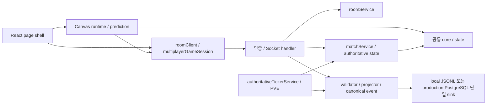

# 저장소 Ponytail audit 대응 패치 계획

- 작성일: 2026-10-25
- 상태: A01~A09 로컬 구현·필수 회귀 완료, 운영 미반영. 추가 ML 검증의 기존 Notebook 상태 실패 1건은 §6에 기록한다.
- 원 조사: 이 대화에서 수행한 저장소 구조·기술 부채 감사의 1~9번 항목
- 재확인 기준: `main` / `08e8c5a` 위 현재 작업 트리. 감사 당시 기준은 `bbf26b7`이다.
- 범위: 운영 접속, 경기 초기화, 로그 완전성·메모리, 사용하지 않는 UI와 중복 코드
- 제외: 이후 진행한 패키지·표준 라이브러리 대체 조사 전체. 과거 [cleanup 완료 계획](codebase-cleanup-plan.md)의 Optional CLI 작업도 이번 범위에 넣지 않는다.
- 별도 제품 계획: [제품 사용성 패치 계획](../design/product-usability-patch-plan.md)

## 1. 목적과 현재 구조

라이브 게임의 접속·판정·데이터 신뢰성을 먼저 고친 뒤, 실제 소비자가 없는 코드와 반복 계산을 줄인다. 삭제 줄 수를 완료 기준으로 삼지 않는다.



전제는 Caddy 뒤 단일 Node process, 방당 두 player, process memory의 실시간 상태다. DB는 분석 event 저장소다. 수평 확장·새 framework·새 저장소는 추가하지 않는다.

현재 [Human 행동 데이터 계약](../ai-ml/contracts/human-action-dataset.md)의 입력은 성공한 키 입력이 아니라 runtime의 처리 시도 기록이다. 이번 패치에서 `createdAt` 의미, 실패 시도 포함, hold 경계, seed·split·원본 데이터는 바꾸지 않는다. 과거 20행 자료와 현재 40행 로그를 혼합하거나 과거 원본을 보정하지 않는다.

## 2. 원 조사 대응표와 순서

| 패치 | 원 감사 번호 | 우선순위 | 현재 확인한 문제 | 선행 조건 |
| --- | --- | --- | --- | --- |
| A01 | 1 | P1 | 신규 세션 제한 key가 Caddy 주소로 합쳐질 수 있음 | 신뢰할 proxy 경계 확정 |
| A02 | 2 | P2 | Human 자연 고정이 expected placement count에서 빠짐 | input·gravity·AI 고정 경로 회귀 확보 |
| A03 | 3 | P2 | 같은 runtime 재시작 때 combo/B2B가 남음 | 없음 |
| A04 | 4 | P2 | 입력·placement history가 경기 길이에 따라 증가하고 전체 입력을 반복 검색 | 로그 consumer·처리 시도 계약 고정 |
| A05 | 5 | P2 | React HUD와 별도로 남은 legacy DOM UI 경로 | production caller 재검색 |
| A06 | 6 | P2, 수집 확대 전 | placement 10건/10초 제한과 저장 실패 보고 부족 | A02, 기존 저장·receipt 계약 확인 |
| A07 | 7 | P2 | Socket input과 ticker의 공격·snapshot 조립 중복 | A02의 동작 기준선 |
| A08 | 8 | P3 | 수집 문맥 없는 싱글에서도 비교 AI 분석 실행 | 없음 |
| A09 | 9 | P3 | 싱글·멀티 `PiecePreview` 중복 | 없음 |

권장 실행 순서는 A01 → A03 → A02 → A06 → A04 → A05 → A07 → A08 → A09다. A08·A09는 다른 패치 없이 독립 적용 가능하다. A06은 기존 증거의 수집 누락을 다루며 새 ML 실험이나 full 실행을 포함하지 않는다.

## 3. 패치별 변경·완료 기준

아래 근거는 조사 당시의 코드와 재현이다. 구현 이후 실제 구조·검증·남은 한계는 §6을 따른다.

### A01. 실제 접속자별 세션 제한

- 근거: [Socket 조립](../../src/server/sockets/index.ts)의 `getRemoteAddress()`는 handshake/transport 주소만 읽는다. [제한 서비스](../../src/server/services/socketRateLimitService.ts)의 신규 세션 한도는 20건/60초다. [Caddyfile](../../Caddyfile)은 app으로 reverse proxy한다.
- 영향: 위 세 파일, [운영 Compose](../../compose.production.yml), 필요 시 [배포 runbook](../operations/deployment/postgres-production-runbook.md), [세션 Socket 테스트](../../test/testPlayerSessionSocket.js), [Socket 보안 테스트](../../test/testSocketSecurity.js). 배포 설정을 바꾸면 [배포 테스트](../../test/testProductionDeployment.js)도 맞춘다.
- 변경: app의 외부 직접 접근 차단과 신뢰할 proxy를 명시한다. Caddy가 덮어쓴 접속 주소만 이 경계에서 읽고, 일반 직접 접속에서는 transport 주소를 사용한다. Express의 `trust proxy`만 설정해 Engine.IO도 해결됐다고 간주하지 않는다.
- 검증: 같은 proxy 뒤 서로 다른 21개 접속자는 독립 허용, 같은 접속자의 21번째 신규 세션은 차단한다. 비신뢰 요청의 위조 forwarding header, 여러 주소, 잘못된 IP가 제한 우회에 쓰이지 않아야 한다. 기존 세션 재개·token rotation은 유지한다.
- 완료: proxy 경계 테스트와 로컬 proxy 통합 확인 후, 실제 운영 적용 시 서로 다른 접속망에서 확인한다. 운영 확인 전에는 코드 검증과 배포 미검증을 구분한다.
- 위험·복구: header를 무조건 믿으면 제한을 우회할 수 있다. app과 proxy 설정을 한 호환 단위로 되돌리고 기존 rate limit은 해제하지 않는다.

### A02. 고정 횟수와 저장 수신증 분리

- 근거: [matchService](../../src/server/services/matchService.ts)의 `countPlacementTarget()`은 Human receipt와 AI event target에서 호출된다. Human의 [ticker](../../src/server/services/authoritativeTickerService.ts) 자연 고정은 이 경로를 거치지 않는다.
- 영향: `matchService.ts`, input [handler](../../src/server/sockets/multiplayerHandlers.ts), ticker, [종료 조립](../../src/server/services/authoritativeMatchFinish.ts), [완전성 검사](../../src/server/db/importJsonl.ts). 테스트는 [match](../../test/testMatchService.js), [ticker](../../test/testAuthoritativeTickerService.js), [importer](../../test/testJsonlImporter.js), [종료·저장 DTO](../../test/testGameEventProjector.js)를 사용한다.
- 변경: 성공한 authoritative 고정의 `pieceIndex`를 count 원천으로 삼는다. input 고정, 입력 직전 lock 만료, gravity 고정을 모두 연결하고 기존 index Set으로 중복 증가를 막는다. AI도 같은 count 의미를 유지한다. Receipt는 Human client log 인증 용도로 유지하며, 자연 고정을 이유로 임의 client sequence의 receipt를 만들지 않는다.
- 검증: grounded 조각의 자연 고정 1회는 expected=1, 실제 로그가 없으면 importer가 tail count mismatch를 보고해야 한다. input/AI 각각 1회, 같은 piece 중복 처리, hold만 수행, 종료 직전 고정도 확인한다.
- 완료: 판정·공격·event 저장 횟수는 그대로이고, 누락 감지만 정확해진다. 자연 고정 로그 수집을 완성한 것으로 보고하지 않는다.
- 위험·복구: 이미 저장된 `game_over` count와 과거 완전성 판정은 소급 수정하지 않는다. 코드 rollback만 수행하고 DB row·원본 로그는 보존한다.

### A03. 새 경기의 combo·back-to-back 초기화

- 근거: [runtime](../../src/client/game/runtime/tetris.ts)의 `resetSessionState()`가 두 값을 초기화하지 않는다. [state 기본값](../../src/client/game/state/stateFactory.ts)은 combo=-1, backToBack=false다.
- 영향: runtime, [runtime 테스트](../../test/testTetrisRuntime.js), [싱글 lifecycle E2E](../../e2e/singleReactLifecycle.spec.js).
- 변경: 새 경기 초기화에 두 기본값을 추가한다. 진행 중 authoritative snapshot 적용은 기존대로 값을 복원한다. 이미 초기화되는 piece index를 별도 버그처럼 수정하지 않는다.
- 검증: combo=3/B2B=true 상태에서 같은 runtime을 `init()`하면 score·lines와 함께 기본값으로 돌아온다. 이어 첫 clear의 공격 계산이 새 게임과 같고, snapshot 복구는 기존 combo/B2B를 유지한다.
- 완료: 반복 싱글 재시작에서 이전 경기 보너스가 전이되지 않는다. 제품 계획 B05 재경기의 선행 회귀다.
- 복구: runtime의 초기화 변경만 되돌린다.

### A04. 전체 기록 보관과 매 placement 전체 검색 제거

- 근거: runtime의 `inputLog`, `placementDecisionLog`는 경기 중 계속 쌓인다. `getInputSequenceForPiece()`는 전체 입력을 filter하고 sequence는 현재 배열 길이로 만든다. `getPlacementDecisionLog()`의 현재 소비자는 테스트다.
- 영향: runtime 타입·recorder와 [runtime 테스트](../../test/testTetrisRuntime.js), [멀티 session](../../src/client/game/entry/multiplayerGameSession.ts), [session 테스트](../../test/testMultiplayerGameSession.js), [버퍼 통합 테스트](../../test/testBufferGameplayIntegration.js).
- 변경 1: 입력 sequence를 보관 배열 길이에서 분리한 경기 내 단조 증가 counter로 만든다. 현재 조각에 필요한 입력만 보관하고 로그에 복사한 뒤 비운다. Hold의 piece index 의미와 correction 시 아직 필요한 문맥을 먼저 고정한다.
- 변경 2: placement log 전체 history와 getter는 production consumer가 계속 없을 때 제거한다. 테스트는 기존 recorder로 필요한 로그를 수집하도록 바꾼다. runtime 안에 테스트 전용 history 옵션을 새로 만들지 않는다.
- 변경 3: 조각을 오래 유지하는 입력도 무제한 보관하지 않는다. 기존 256 KiB payload 한도 안에서 입력 기록 상한을 실제 직렬화 크기로 정하고, 초과 시 불완전 수집을 명시적으로 보고한다. 기존 schema로 조용히 잘라 저장하지 않으며, 보고 계약 변경이 필요하면 이 단계의 별도 작은 패치로 분리한다.
- 검증: 1,000회 고정 후 완료 조각 history를 runtime이 보관하지 않고 sequence는 증가한다. 실패 이동·hold·stale input·correction·마지막 고정·destroy의 기록 의미를 확인한다. 일반 입력에서는 변경 전후 placement 필드가 동일해야 한다.
- 완료: 경기 전체 길이에 비례하는 보관·검색이 사라지고 현재 조각 및 별도 미확정 전송 버퍼에 상한이 있다. 임계값과 초과 보고가 미정이면 전체 A04 완료로 표시하지 않는다.
- 위험·복구: 현재 Human timing 데이터의 timestamp 의미를 바꾸지 않는다. 기존 데이터는 재생성하지 않고 코드만 되돌릴 수 있게 한다.

### A05. React로 대체된 legacy DOM HUD 제거

- 근거: 현재 삭제한 `src/client/game/ui/ui.ts`의 점수·preview·game-over adapter와 [render](../../src/client/game/render/tetrisRender.ts)의 DOM preview 함수가 남아 있었으나 실제 page는 Canvas와 React display bridge를 사용했다.
- 영향: runtime의 DOM 옵션·호출, `ui.ts`, render의 해당 export·타입, [render 테스트](../../test/testTetrisRender.js), runtime fixture·타입 테스트. [display bridge](../../src/client/game/runtime/displayBridge.ts)와 양쪽 page의 React HUD는 유지한다.
- 변경: 삭제 직전에 전 트리에서 caller·문자열 참조·fixture를 다시 검색한다. 사용하지 않는 DOM 옵션과 연결 호출·함수만 제거한다. 보드 Canvas drawing·음향·표시용 snapshot은 유지한다.
- 검증: 싱글·멀티의 score/NEXT/HOLD/Incoming/종료 UI와 StrictMode cleanup이 동작한다. 삭제된 전용 구현 테스트를 유지하려고 호환 adapter를 추가하지 않는다.
- 완료: production에 필요하지 않은 DOM preview 경로와 관련 옵션·export 참조가 0이다.
- 복구: adapter 삭제 패치 하나만 되돌린다. A09의 React component 공유와 별도 변경으로 유지한다.

### A06. 정상 placement 수집 제한과 실패 보고 개선

- 근거: placement 한도는 10건/10초다. [멀티 session](../../src/client/game/entry/multiplayerGameSession.ts)은 emit 뒤 attempt를 settled로 정리한다. 송신 여부와 DB 저장 성공은 다르다. 과거 정상 경기의 25개 예상·21개 저장·4개 RATE_LIMITED 증거는 [버퍼 존 계획](../gameplay/top-out-buffer-zone-plan.md)에 있다.
- 영향: rate limit, Socket log handler·receipt, session과 [결과 page](../../src/client/pages/tetrisMulti.tsx), [roomClient](../../src/client/net/roomClient.ts), 기존 `game:log:result` 계약. 검증은 [멀티 Socket](../../test/testMultiplayerSocket.js), session, [저장 서비스](../../test/testRuntimeEventStorage.js), [placement E2E helper](../../e2e/helpers/placementLogs.js)를 사용한다.
- 변경: 기록된 정상 burst를 fixture로 고정한 뒤 허용 빈도를 정한다. 후보는 60건/10초이며 payload 크기·동시 저장 상한과 함께 측정해 확정한다. 제한 삭제나 무한 queue로 해결하지 않는다.
- 변경: 저장 실패를 session/page의 수집 상태로 전달하고 이유·실패 건수를 확인할 수 있게 한다. 경기 판정은 계속 진행한다. 현재 성공 응답의 상관관계와 receipt 소비 시점을 확인하며, 첫 패치에 무조건 재전송을 추가하지 않는다. 재시도가 필요하면 식별자·멱등성·receipt와 bounded pending을 함께 설계한 별도 패치로 둔다.
- 검증: 정상 burst의 expected/stored count가 같고 quota 손실이 없다. 공격적 burst는 차단하며 RATE_LIMITED·DB 실패·disconnect는 확인 가능한 수집 실패로 남는다. receipt 위조·중복 저장 차단은 유지한다.
- 완료: 정상 속도 수집 손실을 없애고 실패를 성공으로 취급하지 않는다. A02가 감지한 자연 고정의 관찰 문맥 부족은 별도 알려진 한계로 남긴다.
- 위험·복구: 단일 sink·저장 in-flight·timeout 한도를 유지한다. 한도 변경만 되돌릴 수 있도록 실패 보고와 커밋을 분리한다. 원본 삭제·DB rollback은 하지 않는다.

### A07. 공격 반영과 snapshot 조립의 중복만 공유

- 근거: Socket handler의 `handleServerPlacementResult`/`emitAuthoritativeSnapshot`과 ticker의 대응 함수가 같은 공격·DTO 조립을 수행한다.
- 영향: 두 모듈, 기존 [playerGameplayStep](../../src/server/services/playerGameplayStep.ts)와 [matchService](../../src/server/services/matchService.ts) 중 책임이 맞는 위치, [공격 테스트](../../test/testCombatEffect.js), Socket·ticker 테스트.
- 변경: 공통 부분만 기존 모듈의 작은 함수로 모은다. timer, async mutation FIFO, game finish, log 저장을 하나의 새 manager로 합치지 않는다. ticker의 현재 의존성 주입과 fake 테스트를 보존한다.
- 검증: input·gravity·AI 각각에서 garbage 반영 후 snapshot이 나가고 presentation/combat effect·gameId가 같다. 중복 emit·공격·종료가 없다.
- 완료: 같은 payload 규칙을 두 곳에서 수정하지 않아도 되고 이벤트 순서는 그대로다.
- 복구: 공유 함수 이동 패치만 되돌린다.

### A08. 수집 문맥 없는 heuristic 비교 분석 생략

- 근거: runtime은 `createHumanPlacementLogAnalysis()`를 호출한 뒤 gameId/roomId/playerId를 검사한다. 싱글은 비교 결과를 로그에 채우지 못한다.
- 영향: runtime의 해당 분기, runtime 로그 테스트. gameplay·raw attack 계산은 그대로 둔다.
- 변경: 기존의 세 ID 유효 조건을 비싼 분석 호출 앞에 둔다. recorder 존재만으로 수집 가능 여부를 새로 정의하지 않는다.
- 검증: 수집 문맥 없는 고정은 비교 분석을 실행하지 않으며 board·score·기본 로그가 같다. 정상 멀티 로그에는 기존 metrics/evaluation/aiComparison이 남는다.
- 완료·복구: 분석 호출만 감소한다. 결과 schema·AI 선택은 바꾸지 않고 분기 이동만 되돌릴 수 있다.

### A09. 실제로 같은 PiecePreview 한 개 공유

- 근거: [싱글 page](../../src/client/pages/tetrisSingle.tsx)와 [멀티 page](../../src/client/pages/tetrisMulti.tsx)에 같은 component가 있다.
- 영향: 두 page와 작은 표시 전용 component 파일 하나. 처음 공유되는 실제 중복이며 공통 UI framework·context는 만들지 않는다.
- 변경: 현재 props·JSX·class·20px 계산을 그대로 옮긴다. 게임 queue나 state 소유권은 옮기지 않는다.
- 검증: 7개 piece·null·NEXT shapeOnly·HOLD에서 기존 DOM과 class가 같다. 기존 page lifecycle·preview E2E를 사용한다.
- 완료·복구: 두 page가 한 구현을 사용한다. 추출 패치 하나만 되돌린다.

## 4. 구현 때의 검증과 변경 경계

각 패치 직전에 HEAD·dirty·caller를 다시 확인하고 최소 재현을 고정한다. 한 패치의 관련 검증과 아래 기본 검증을 통과한 뒤 다음 패치로 넘어간다. 코드 변경 시 실제 결과를 PLAN과 change-log에 추가한다.

```bash
nvm use
bash scripts/verify.sh
```

| 변경 | 추가 검증 |
| --- | --- |
| A01 | fake proxy/직접 접속 회귀, 로컬 Caddy 통합; 운영 적용 시 서로 다른 접속망 |
| A02·A06 | `npm run test:db`로 count·event 보존 관련 경로 확인; 실제 운영 DB에 테스트를 쓰지 않음 |
| A03·A04·A05·A08·A09 | `npm run test:e2e -- e2e/singleReactLifecycle.spec.js e2e/multiplayerReactLifecycle.spec.js e2e/multiplayerRollback.spec.js` |
| A06 | `npm run test:e2e -- e2e/multiplayerPve.spec.js e2e/multiplayerGameOver.spec.js`와 수집 누락 fixture |
| A07 | `npm run test:e2e -- e2e/combatAchievements.spec.js e2e/multiplayerRollback.spec.js e2e/multiplayerPve.spec.js` |

ML 계약·feature·dataset 생성 결과를 실제로 바꾸는 경우에만 해당 ML 명세의 targeted 검증과 `npm run verify:ml`을 추가한다. Full 생성·학습·운영 배포는 이 계획서 작성으로 시작하지 않는다.

완료 보고는 패치 ID, 실제 diff, 통과/실패/미검증, 원본 보존, 복구 단위를 기록한다. 현재 수치는 재실행하지 않은 이전 감사·기존 문서 증거이며 새 검증 결과로 인용하지 않는다.

## 5. 계획 작성의 확인 범위

계획 작성 당시에는 코드와 caller·기존 테스트·운영 설정을 확인하고 문서만 작성했다. 이후 사용자의 audit plan 실행 요청에 따라 아래 구현·검증을 수행했다. 패키지 대체 조사와 별도 제품 계획은 실행하지 않았다.

## 6. 로컬 실행 결과 (2026-10-25)

- 기준: `08e8c5a`와 실행 시작 때의 사용자 미커밋 변경을 보존한 작업 트리. 현재 감사 패치는 미커밋 상태다.
- A01 → A03 → A02 → A06 → A04 → A05 → A07 → A08 → A09 순서로 적용하고 각 단계에서 관련 검사와 필수 verify를 실행했다. source는 공유 preview 신규 파일을 포함해 **202줄 추가 / 561줄 삭제 / 순감소 359줄**이다. package.json·lockfile·DB schema는 변경하지 않았다.

| 패치 | 실제 결과 | 확인한 증거 |
| --- | --- | --- |
| A01 | 신뢰할 proxy IP만 X-Real-IP 사용. Compose edge에서 Caddy `.2`, app `.3`을 고정하고 Caddy가 헤더를 덮어씀 | 다른 21명 독립 허용·같은 IP 21번째 차단, IPv4-mapped/IPv6/위조·복수·scoped 주소, 격리 Docker network 실제 peer·header 검증 |
| A03 | init에서 combo=-1/B2B=false. Snapshot 복구 값은 보존 | 같은 runtime 재시작 회귀와 싱글 반복 restart E2E |
| A02 | input·입력 직전 lock 만료·gravity commit에서 count. Receipt 발급은 count하지 않음 | 세 commit 경로·hold 제외·receipt 중복 회귀, 기존 tail mismatch 검사와 PostgreSQL 계약 |
| A06 | placement 한도 60건/10초. 전송 실패 반환·수집 오류 횟수 표시·이유는 진단 로그로 전달 | 25건 burst 저장·61번째 차단, 전송 예외 중복 통지 방지, 화면 실패 안내 E2E |
| A04 | 전체 placement history/getter 삭제. 입력 sequence 독립·piece buffer만 보관 | 1,000 placement 후 완료 기록 0, 상한 초과 시 전체 로그 저장 생략·오류 통지, ack 없는 128개 초과도 한 번씩 보고 |
| A05 | legacy DOM UI·preview export·옵션 삭제. React display bridge 유지 | source caller 0, HUD snapshot 회귀와 production 싱글/멀티 lifecycle E2E |
| A07 | `applyPlacementAttack`·`getAuthoritativeSnapshotPayload`를 기존 matchService에서 공유 | Socket/ticker/PVE/공격 관련 164개 통과, 입력 후 공격·snapshot 순서와 E2E |
| A08 | 유효한 gameId/roomId/playerId를 분석 호출 전에 확인 | 기존 수집/비수집 로그 검사 유지, 1,000 placement 결정적 테스트 실행 약 1.28초→0.06초. 이 테스트 시간은 일반 게임 FPS 측정이 아님 |
| A09 | [공용 PiecePreview](../../src/client/game/ui/piecePreview.tsx)를 싱글/멀티가 사용 | 추출 전 두 함수 본문 동일 확인, 타입·build·실제 NEXT/HOLD와 lifecycle E2E |

### 수집 상한과 보존 계약

- 한 조각의 처리 시도 기록은 1,024건·직렬화 128 KiB 중 먼저 도달하는 상한을 사용한다. 이는 학습 품질 선정 기준이 아니라 client 자원 한도다. 초과한 조각은 잘린 정상 로그로 저장하지 않고 `INPUT_LOG_TOO_LARGE`를 보고한다. 다음 조각은 다시 수집한다.
- session의 미확정 placement attempt는 128개, 최근 settled key는 256개로 제한한다. 초과는 `PLACEMENT_BUFFER_FULL`로 보고한다. receipt 1회 사용 계약 때문에 자동 재전송은 추가하지 않았다. emit 성공은 영속 저장 성공이 아니다.
- Human 자연 고정의 count는 이제 반영되지만 해당 client log의 authoritative lineage·관찰 문맥 수집이 완성됐다는 뜻은 아니다. 실패·연결 복구·종료에서 이미 저장됐는지 불명확한 요청의 복구는 보장하지 않으며, 기존 연결 안내와 expected/stored count로 함께 확인해야 한다.
- Date.now 생성 위치·실패 입력 포함·hold의 piece 의미·정상 로그 schema는 유지했다. HEAD의 source를 임시 경로에 읽기 전용으로 추출해 hold·실패 이동·snapshot 보정·줄 삭제의 **v3 로그 3개 bytes 동일**을 확인했다. 합친 JSON SHA-256은 `12e925d371cc7ba4a44c10f5171a30756006bef0a1ba24c1252af049b848c31b`다.
- recorder가 history를 보관하지 않는 별도 5,000 placement 실행에서 GC 후 heapUsed는 약 11.40~11.42 MB, RSS는 약 121.83~128.16 MB였다. 완료된 input 기록은 항상 0이고 sequence=5,000이었다. 단일 synthetic 실행이며 운영 용량·동접 한계 근거로 사용하지 않는다.
- 원본 데이터·기존 report·Notebook 실행본은 수정하지 않았다. 향후 운영 적용 build와 수집 조건은 배포 시 별도로 기록하며 과거 데이터를 소급 재작성하지 않는다.

### 최종 검증

| 검사 | 결과 |
| --- | --- |
| `bash scripts/verify.sh` | 타입·build·artifact 통과, Node **789 pass / 0 fail / 기존 조건부 1 skip** |
| 관련 production Chromium E2E 7개 파일 | **30/30 pass**: 싱글·멀티 lifecycle, rollback, session 복구, PVE, game-over, 전투·수집 오류 표시 |
| `npm run test:db` | 임시 PostgreSQL **9/9 pass**, migration 두 번·중복/충돌·single sink·startup gate·DB 실패·source-less release 포함, 생성 자원 정리 |
| Compose·Caddy | config 통과, pinned Caddy의 header 덮어쓰기·고정 peer 통과, 기존 CD의 503 치환 결과도 실제 Caddy validate 통과 |
| 추가 `npm run verify:ml` | Node **35/35 pass**, Python **162/163 pass**. 사용자 timing Notebook에 실행 count/output이 남아 있다는 기존 source 형식 검사 1개 실패 |

ML 실패는 `test_human_timing_dataset_notebook.HumanTimingDatasetTest.test_notebook_contract_and_no_duplicate_parser_or_trainer`의 `execution_count is None` assertion이다. 사용자 실행본의 count=2 등을 지우지 않았다. 확인한 파일 SHA-256은 `0805dd77ed33e4ca8794f3726f988a7a2b3cf6df52318fa41a65fe2390c0a07d`다. 추가 ML 전체 suite 통과로 보고하지 않으며, 이번 감사에서 학습·Notebook 정리는 수행하지 않는다.

### 남은 적용 경계

운영 설정은 아직 반영하지 않았다. [proxy 적용·복구 절차](../operations/deployment/postgres-production-runbook.md#audit-a01-proxy-접속-주소-적용과-복구-2026-10-25)에 따라 subnet 충돌·동접·기존 Caddy 설정을 확인하고 app/Caddy의 호환 설정을 함께 반영해야 한다. 운영의 서로 다른 접속망 검증과 실제 장시간 부하는 미검증이다. git stage/commit/push와 제품 B01~B06은 실행하지 않았다.
