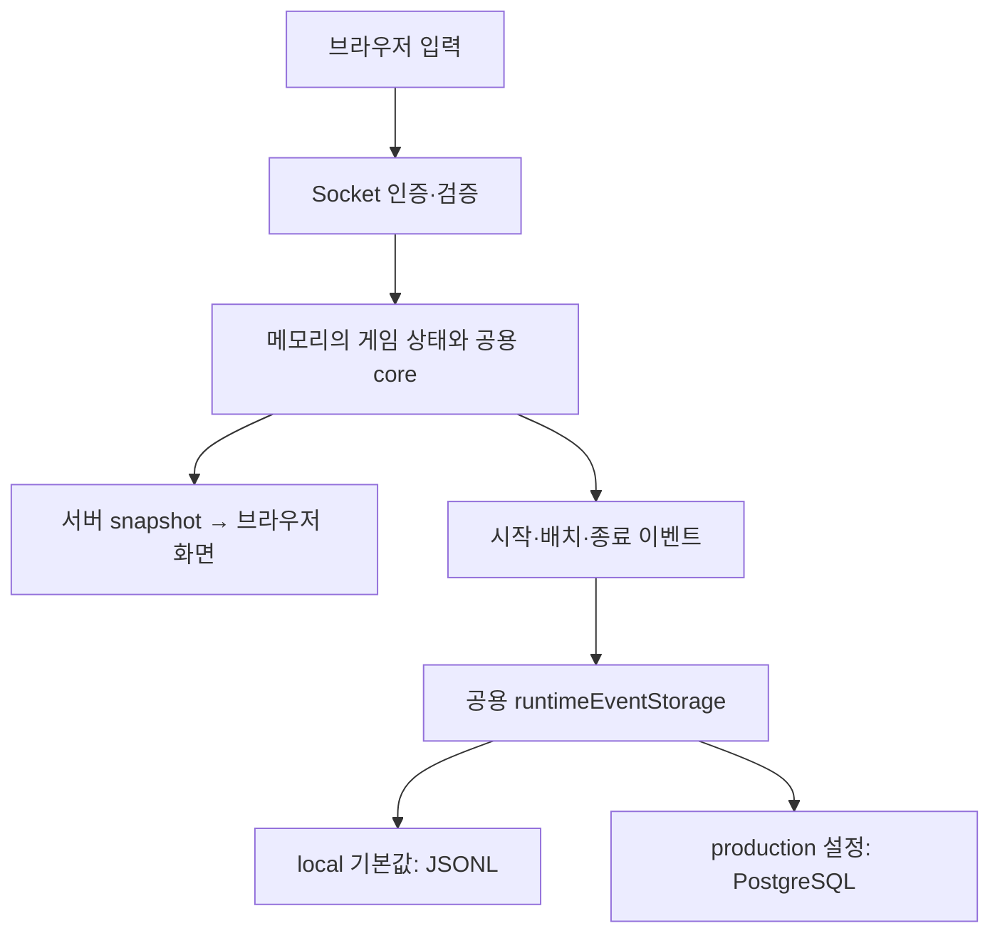

# 프로젝트 DB 연결과 처리 흐름

작성일: 2026-10-19 (Asia/Seoul)

프로젝트가 DB를 왜 사용하고, 어떻게 연결하며, 어떤 데이터를 검증·저장하는지
설명한다. 사용자가 질문한 **여러 룸의 동시 입력, 멱등성과 원자성**도 이 흐름 안에서 다룬다.
현재 소스와 Compose 설정을 기준으로 작성했으며 실제 운영 서버의 현재 상태를
조회한 보고서는 아니다. 상세 설계는 [Blueprint](database-event-storage-blueprint.md),
실행 명령과 운영 절차는 [운영 runbook](../deployment/postgres-production-runbook.md)을 따른다.

## 1. DB는 게임을 진행시키는 곳이 아니라 게임 기록을 보관하는 곳이다

실시간 방·경기·플레이어 보드는 Node.js 프로세스 메모리에 있다.
서버는 입력과 중력을 core에 적용하고 결과를 Socket.IO snapshot으로 전달한다.
매 입력마다 DB에서 보드를 조회하거나, snapshot을 DB에 저장한 뒤 화면에 보내지 않는다.

PostgreSQL은 다음 세 이벤트를 장기 보관한다.

| 이벤트 | 기록 시점과 주요 내용 |
| --- | --- |
| `game_start` | 경기 시작, 게임 ID·참가자·모드·시작 시각 |
| `placement_decision` | 블록 배치 확정, 배치 전후 보드·조각·선택 위치·metric·입력 문맥 |
| `game_over` | 경기 종료, 승패·종료 사유·종료 시각·예상 배치 이벤트 수 |

모든 키 입력·중력 tick·실시간 snapshot이 각각 DB 행이 되는 것은 아니다.
일부 입력 문맥은 placement의 `inputSequence` 안에 포함된다.
앱 재시작 뒤 로그는 남지만 진행 중이던 room/match를 DB에서 자동 복구하는 기능은 없다.



위 저장 경로는 mode에 따른 대안이다. 한 프로세스에서 두 경로에 동시에 쓰지 않는다.

## 2. 환경에 따라 저장소를 하나 선택한다

원천: [runtimeEventStorage.ts](../../../src/server/services/runtimeEventStorage.ts).

| 환경/설정 | 동작 |
| --- | --- |
| local/test에서 `GAME_EVENT_STORAGE` 미지정 | JSONL 사용 |
| `GAME_EVENT_STORAGE=jsonl` | 기존 파일 저장 경로 사용 |
| `GAME_EVENT_STORAGE=postgres` | PostgreSQL 저장 경로 사용, `DATABASE_URL` 필수 |
| production에서 mode 미지정 또는 잘못된 mode | 시작 실패 |

JSONL은 [logService](../../../src/server/services/logService.ts)의 검증 후
[jsonlLogRepository](../../../src/server/repositories/jsonlLogRepository.ts)가 한 줄씩 append한다.
기본 경로는 `data/logs/game-events.jsonl`이고 `GAME_EVENTS_LOG_PATH`로 바꿀 수 있다.
JSONL 경로를 DB의 UNIQUE 제약·멱등 저장과 같은 것으로 간주하지 않는다.

PostgreSQL이 실패했다고 JSONL로 조용히 전환하지 않는다. mode는 시작 때 정하며,
운영자가 실패를 파악할 수 있도록 결과와 warning을 남긴다.

## 3. 운영에서 DB를 연결하는 방법

[compose.production.yml](../../../compose.production.yml)은 app, postgres, caddy를 실행한다.
브라우저는 Caddy와 app에 접속하고 PostgreSQL에는 직접 접속하지 않는다.
PostgreSQL 5432는 호스트 공개 포트로 publish하지 않으며 app은 Docker 내부
network에서 `postgres` hostname으로 접근한다. DB 파일은 `postgres_data` volume에 보존한다.

환경값은 `/srv/tetris/secrets/production.env`에서 Compose에 공급한다.
앱에는 다음 설정이 전달된다. 실제 비밀번호는 이 문서나 이미지에 넣지 않는다.

```text
GAME_EVENT_STORAGE=postgres
DATABASE_URL=postgresql://<runtime-user>:<password>@postgres:5432/tetris?sslmode=verify-full
NODE_EXTRA_CA_CERTS=/run/secrets/postgres-ca.crt
```

`DATABASE_URL`은 접속 주소·DB 이름·사용자·비밀번호를 담는 연결 문자열이다.
앱은 ORM 대신 `pg` 드라이버와 직접 작성한 parameterized SQL을 사용한다.
parameterized SQL은 값들을 `$1`, `$2` 같은 자리로 전달해 SQL 문법과 분리하는 방식이다.

[postgresConnection.ts](../../../src/server/db/postgresConnection.ts)는 URL을 검사한 뒤
허용한 값만 `pg` 설정으로 전달한다. non-loopback 연결은 인증서와 hostname을 확인하는
TLS 연결을 요구한다. Compose는 CA 인증서를 read-only로 mount하고
`NODE_EXTRA_CA_CERTS`를 지정한다. 코드에는 별도 `DATABASE_CA`를 전달하는 경로도 있다.
검증되지 않은 URL 옵션이나 주변 `PG*` 환경값으로 연결 설정이 바뀌는 것을 막는다.

loopback은 같은 컴퓨터의 `localhost`, `::1`, 유효한 127/8 주소를 말하며,
격리된 로컬 테스트에서는 TLS 없이 사용할 수 있다.

## 4. 서버 시작 순서

[init.ts](../../../src/server/init.ts)의 `startServer()`는 다음 순서로 동작한다.

1. `createRuntimeEventStorage()`를 한 번 호출한다.
2. PostgreSQL mode이면 `pg.Pool`을 만들고 연결·schema migration version을 확인한다.
3. 현재 코드가 기대하는 migration version `2`와 맞지 않거나 연결이 실패하면 시작하지 않는다.
4. 같은 저장소의 `saveGameEventLog`, `savePlacementDecisionLog`를 소켓 등록 함수에 전달한다.
5. [sockets/index.ts](../../../src/server/sockets/index.ts)가 이 저장 함수를 모든 룸의
   handler와 공용 ticker/AI 경로에 전달한다.
6. 이 준비가 끝나면 HTTP/Socket.IO 서버가 listen한다.

시작 검사는 migration 이력의 최대 version 확인이다. 실제 제약·권한 전체를
매 시작마다 감사하는 것은 아니며, 그 범위는 DB 통합 테스트와 운영 점검이 담당한다.

## 5. 로그가 생성되고 검증되는 순서

Human placement는 브라우저가 보내지만 그대로 신뢰하지 않는다.
[multiplayerHandlers.ts](../../../src/server/sockets/multiplayerHandlers.ts)는 active session,
room 권한, schema와 rate limit을 확인하고, 서버가 실제 배치를 처리했다는 receipt를 검사한다.
receipt는 서버가 보관한 배치 확인 기록이며 client sequence·piece index와 연결된다.
게임·방·플레이어 ID를 서버/session 값으로 맞춘 뒤 schema를 다시 검증한다.

이 확인은 배치 사건의 서버 처리 여부와 소유권을 확인하는 것이다.
Human payload 전체가 서버가 생성한 정보라는 뜻은 아니므로 DB에는
`trust_level=client_reported`로 저장한다.

시작·종료 이벤트와 서버 heuristic AI 배치는 서버 코드가 생성하며
`trust_level=server_authoritative`로 저장한다. Experimental V4 AI placement는
현재 PVE service에서 Human/heuristic 학습 로그로 섞이지 않도록 제외하는 경로가 있다.

```text
인증된 Human 로그 또는 서버 생성 이벤트
→ gameLogValidator: 자료형·필수 필드·크기 검사
→ gameEventProjector: 허용 필드만 골라 canonical event 생성
→ prepareCanonicalGameEvent: immutable 복사본·고유 ID·내용 hash 계산
→ runtimeEventStorage: 동시 저장 상한·재시도 관리
→ postgresEventRepository: SQL 실행
→ tetris_analytics.game_events
```

[gameEventProjector.ts](../../../src/server/services/gameEventProjector.ts)는 필요한 필드만
명시적으로 복사한다. nickname·token·IP·credential 같은 필드를 DB payload에
복사하지 않는다. `playerId`는 식별 가능한 telemetry이므로 보존·추출 관리 대상이다.
raw log와 canonical event에는 각각 256 KiB 상한이 적용된다.

Human log handler는 별도의 로그 요청에서 저장 결과를 기다린 뒤 `game:log:result`를 보낸다.
이 대기가 게임 입력 mutation queue의 DB 대기는 아니다.
시작·종료·heuristic AI 저장은 gameplay를 막지 않는 비동기 부작용으로 시작하고,
나중에 실패하면 warning을 남긴다. AI의 `LOG_WRITE_SCHEDULED`는 저장 완료가 아니다.

## 6. 테이블에 무엇이 들어가는가

현재 분석 이벤트 테이블은 `tetris_analytics.game_events`다.
`schema_migrations`는 별도로 DB 구조 적용 이력을 기록한다.

| 컬럼 | 의미 |
| --- | --- |
| `event_id` | 사건 식별 조합을 hash한 기본키 |
| `event_sha256` | 사건 전체 내용의 hash, 같은 사건의 내용 변경 감지 |
| `identity_version`, `schema_version` | 식별 규칙과 이벤트 형식의 버전 |
| `event_type` | 시작·배치·종료 종류 |
| `game_id` | 한 경기의 ID. 새 match마다 UUID 생성 |
| `player_id`, `piece_index` | 배치한 플레이어와 조각 번호. lifecycle에서는 null |
| `trust_level` | client reported 또는 server authoritative |
| `occurred_at` | 이벤트가 발생한 시각 |
| `payload` | 보드·선택 위치·게임 문맥 등의 JSONB 객체 |
| `ingested_at` | DB가 기록한 수집 시각 |

JSONB는 PostgreSQL의 JSON 저장 자료형이다. 모든 데이터가 자유형 JSON 안에만
들어가는 것은 아니며, 조회·고유성·검증에 중요한 식별값은 별도 컬럼으로 둔다.
roomId는 이벤트 payload에 포함되고, 기본 게임 식별 원천은 `game_id`다.

DB의 CHECK·NOT NULL 제약은 필수값과 자료형 문맥을 검사하고, 기본키와 UNIQUE
인덱스는 중복 사건을 막는다. 실제 정의는
[001 SQL](../../../src/server/db/migrations/001_game_events.sql)과
[002 SQL](../../../src/server/db/migrations/002_lifecycle_event_v2.sql)의 적용 결과다.

## 7. 여러 룸에서 동시에 조작하면 어떻게 저장되는가

사용자 질문의 '동시'는 같은 플레이어의 빠른 연속 입력보다,
여러 룸 플레이어가 같은 시점에 조작하는 상황을 뜻한다.

게임 상태 변경은 `roomId + playerId`별 mutation queue로 순서를 지킨다.
서로 다른 룸·플레이어는 같은 queue key를 사용하지 않는다.
그 결과 생성된 로그는 룸별 DB를 만드는 대신 공용 저장소와 테이블에 보낸다.

```text
A룸 / 게임 A / 플레이어 A / 조각 20 ─┐
B룸 / 게임 B / 플레이어 B / 조각 20 ─┼→ 같은 pool → 서로 다른 DB 행
C룸 / 게임 C / 플레이어 C / 조각 20 ─┘
```

모든 조각 번호가 20이어도 game/player 식별값이 달라 충돌하지 않는다.
한 룸의 로그가 다른 룸 로그를 덮어쓰는 UPDATE 경로는 없다.

| 공용 제한 | 현재 코드값 |
| --- | ---: |
| 앱 pool 최대 연결 | 4 |
| 앱 진행 중 저장 요청 최대 | 16 |
| 연결 확보·연결 timeout | 200ms |
| client query / server statement timeout | 각각 200ms |
| 저장 시도 | 최초 포함 최대 3회 |
| 재시도 backoff | 50ms, 100ms |
| 재시도 시간 budget | 2,700ms |
| PostgreSQL 전체 최대 연결 설정 | 20 |

pool은 연결을 재사용하는 장치다. 예를 들어 6건이 들어오면 최대 4개 연결로
쿼리를 처리하고 다른 허용 요청은 연결을 기다린다. 대기도 timeout의 영향을 받는다.
16건이 끝나지 않은 상태에서 추가 저장 요청이 들어오면 `IN_FLIGHT_LIMIT`으로 거부한다.
`inFlight`는 진행 중 Promise를 추적하는 Set이며 디스크에 보존되는 작업 queue가 아니다.

4와 16은 **앱 프로세스 전체 기준**이며 룸 수·플레이어 수의 상한이 아니다.
별도 룸별 저장량 할당이 없으므로 한 룸의 과도한 이벤트는 다른 룸의 저장에도
영향을 줄 수 있다. 실제 지원 가능한 룸 수는 이벤트 빈도와 DB 지연을 측정해야 한다.
여러 앱 프로세스로 늘리면 이 pool 제한도 프로세스별로 생기며, 현재 한 프로세스의
메모리 room/match 구조까지 자동 분산되는 것은 아니다.

## 8. 멱등성: 같은 사건을 반복 저장해도 한 건만 남긴다

[canonicalGameEvent.ts](../../../src/server/db/canonicalGameEvent.ts)는 다음 조합으로
`event_id`를 만든다. JSON 표현을 결정적으로 정리한 뒤 SHA-256을 계산한다.

```text
시작: [identity-v1, game_start, gameId]
배치: [identity-v1, placement_decision, gameId, playerId, pieceIndex]
종료: [identity-v1, game_over, gameId]
```

별도로 전체 immutable event의 내용 hash인 `event_sha256`를 만든다.
DB 수집 시각 `ingested_at`은 이 hash에 포함하지 않는다.

[postgresEventRepository.ts](../../../src/server/repositories/postgresEventRepository.ts)의
SQL은 `INSERT ... ON CONFLICT DO NOTHING RETURNING event_id`다.
먼저 SELECT로 유무를 검사한 뒤 INSERT하는 방식이 아니라 DB 고유 제약으로 동시 중복을 막는다.

- 삽입 성공: `inserted`
- 삽입되지 않아 조회한 기존 식별값·내용 hash까지 같음: `duplicate`, 성공 취급
- 같은 식별 사건의 내용이 다름: `IDEMPOTENCY_CONFLICT`, 실패, 기존 행 보존

고유성은 `event_id` 기본키와 의미상 사건 조합의 UNIQUE 인덱스가 함께 지킨다.
같은 번호의 조각을 두 번 저장해도 단순히 마지막 값으로 덮어쓰지 않는다.
시각도 event 내용이므로 같은 사건을 새 timestamp로 재생성하면 충돌할 수 있다.
현재 내부 재시도는 이미 만든 동일 canonical event를 사용한다.

## 9. 원자성과 순서가 보장되는 범위

트랜잭션은 DB 작업을 하나의 성공·실패 단위로 묶는 것이다.
원자성은 그 단위가 통째로 반영되거나 반영되지 않는 성질이다.

| 범위 | 현재 동작 |
| --- | --- |
| 로그 한 행의 INSERT | 개별 SQL 트랜잭션으로 원자적 처리 |
| INSERT 후 duplicate/conflict 확인 SELECT | 별도 SQL 명령. 둘을 한 트랜잭션으로 묶지 않음 |
| 한 경기의 시작·모든 배치·종료 | 개별 이벤트 저장이며 전체 원자성 없음 |
| 여러 룸의 이벤트 | 각자 저장, 한 룸 실패로 다른 룸 성공을 취소하지 않음 |
| 메모리 gameplay 변경 + DB INSERT | 하나의 트랜잭션이 아님 |
| 전체 이벤트 저장 완료 순서 | 발생 순서와 같다고 보장하지 않음 |

따라서 게임에서 배치는 성공했지만 해당 로그 저장은 실패하는 상황이 가능하다.
분석 시 `ingested_at` 순서만으로 플레이 순서를 확정하지 않고 gameId·조각 번호와
`occurred_at`을 함께 본다. 매 입력마다 DB를 기다려 gameplay를 복구하는 구조가 아니다.

## 10. 오류, 재시도와 서버 종료

일시 연결 오류·timeout·재시도 가능한 PostgreSQL 오류만 정해진 범위에서 다시 시도한다.
잘못된 로그, 제약 위반과 내용 충돌은 무조건 재시도하지 않는다.
실패는 안전한 오류 코드·event type·시도 횟수 warning과 메모리 counter에 기록한다.
raw payload·비밀번호·연결 URL을 warning에 출력하지 않는다.
`getMetrics()`는 있지만 현재 HTTP 운영 dashboard로 노출하는 경로는 없다.

현재 수집은 best-effort다. 가능한 범위에서 저장하지만 장애·과부하·프로세스 crash에도
모든 이벤트가 반드시 전달된다는 보장은 없다. 재시도만으로 exactly-once 전달을
보장한다고 표현하지 않는다. 영속 outbox/메시지 broker는 현재 구현되어 있지 않다.

SIGTERM 종료에서는 신규 write 차단 → Socket/ticker 생산 중지 → 최대 3초 진행 중
write 대기 → pool 닫기 → Socket.IO/HTTP 닫기 순서로 정리한다.
전체 종료 hard deadline은 8초다. 강제 종료 시의 무손실 저장을 의미하지 않는다.
원천: [serverShutdown.ts](../../../src/server/serverShutdown.ts).

## 11. DB 구조와 접근 권한은 누가 관리하는가

migration은 DB 테이블·제약을 버전별로 변경하는 작업이다.
`npm run db:migrate`는 별도 `MIGRATION_DATABASE_URL`을 사용하며 HTTP startup과 분리한다.
SQL 파일 version·checksum을 확인하고 advisory lock으로 migration의 동시 실행을 조정한다.
각 migration의 SQL과 이력 기록은 같은 트랜잭션으로 처리한다.
적용된 파일 내용이 바뀌면 checksum 불일치로 거부한다.
원천: [migrate.ts](../../../src/server/db/migrate.ts).

운영 runbook은 권한을 다음과 같이 나눈다. role 생성·권한 부여는 별도 provisioning이다.

| 역할 | 용도 |
| --- | --- |
| migration | schema·table 구조 관리와 소유 |
| runtime | 허용된 이벤트 INSERT, 중복·schema version 확인용 제한된 SELECT |
| import | 기존 로그를 가져올 때 제한된 INSERT/SELECT |
| maintenance | 승인된 보존 관리용 조회·삭제 |

앱에는 runtime credential만 전달한다. runtime에는 UPDATE·DELETE·TRUNCATE나
테이블 생성 권한을 주지 않는 것이 운영 계약이다. 이 권한이 실제 서버에도 그대로
적용되어 있는지는 운영 role 조회 또는 DB 통합 검증이 필요하다.

## 12. 기존 로그 가져오기, 조회, 학습 데이터와의 관계

`npm run db:import-jsonl`은 기존 앱 JSONL 이벤트를 DB에 가져오는 별도 도구다.
streaming 입력, dry-run, 원본 checksum, 중복·충돌 결과와 게임 완전성 report를 지원한다.
쓰기에는 `IMPORT_DATABASE_URL`을 사용한다. DB row dump를 그대로 다시 넣는 도구로
간주하지 않는다. 원천: [importJsonl.ts](../../../src/server/db/importJsonl.ts).

DB 조회·CSV/JSONL export는 운영 runbook의 `psql` 절차를 사용한다.
일반 runtime 계정은 payload 전체를 자유롭게 읽는 분석 계정이 아니다.
표준 export는 전체 테이블 snapshot이며 과거 기록도 포함한다.
이전 덤프와 단순 연결하면 중복될 수 있어 event identity를 기준으로 다룬다.

DB에서 내보낸 JSONL은 `event_type`, `game_id`, `payload` 형태의 DB row다.
기존 placement dataset exporter가 기대하는 앱 이벤트 JSONL과 형식이 다르다.
학습에 쓰려면 변환·정제와 gameId 단위 split이 필요하며, runtime DB에서 모델이
자동으로 학습되거나 새 로그가 생길 때 운영 AI가 자동 갱신되지는 않는다.
[정제·학습 계획](../../ai-ml/strategy/new-log-cleaning-training-plan.md)을 별도로 따른다.

백업은 `pg_dump`, 복원 확인은 `pg_restore` 절차를 사용한다.
앱 이미지를 교체해도 volume은 유지하고 rollback에서 DB 행·volume을 삭제하지 않는다.
runbook에 보존 목표와 수동 점검 절차가 있으며 자동 backup·retention·경고가 모두
구현됐다고 해석하지 않는다.

## 13. 확인한 근거와 미검증 범위

이번 DB 조사에서 Node 24.18.0 server build와 다음 관련 테스트 38개가 통과했다.

```bash
node --test test/testCanonicalGameEvent.js test/testRuntimeEventStorage.js \
  test/testAuthoritativePlayerMutationQueue.js test/testPostgresConnection.js \
  test/testServerShutdown.js
```

이 테스트에는 저장소 stub을 사용한 재시도·16개 상한·종료 검사 등이 포함된다.
실제 PostgreSQL 동시 실행 검증과 구분한다.
[DB 통합 테스트](../../../test-integration/postgresSchemaRepository.js)에는 같은 이벤트를
12번 동시에 append해 inserted 1건·duplicate 11건과 DB 행 1건을 확인하는 검사,
PVP/PVE 저장·16개 동시 write와 지연 검사 등이 있다.

실제 DB 통합 명령은 `npm run test:db`이며 격리된 Docker PostgreSQL을 만든다.
이번 조사에서는 로컬 Docker daemon이 실행되지 않아 이 검증을 새로 실행하지 못했다.
운영 서버에도 접속하지 않아 실제 이미지·접속 수·현재 row·저장 오류·누락률과
동시 룸 처리 한계는 확인하지 않았다.

이 문서는 DB 구조나 저장 정책을 변경하지 않는다. 현재 핵심 보장은 **사건별 중복 방지와
한 행의 원자적 저장**이며, **모든 방의 모든 이벤트가 빠짐없이 도착하는 보장**까지는 아니다.
