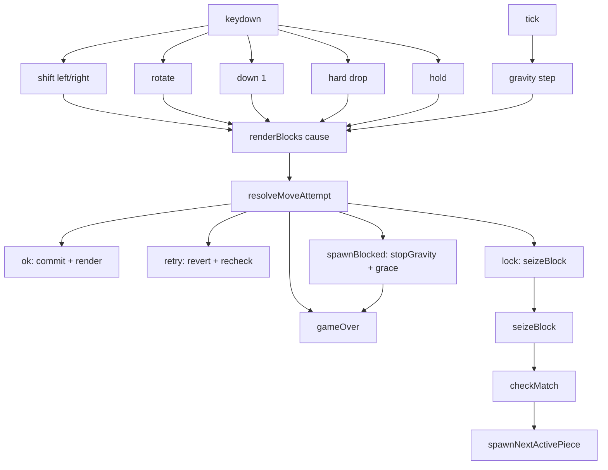
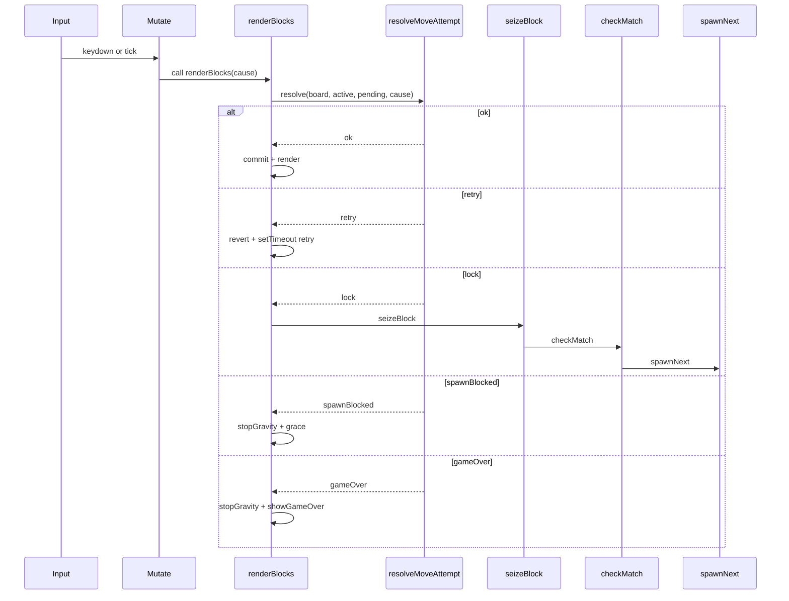
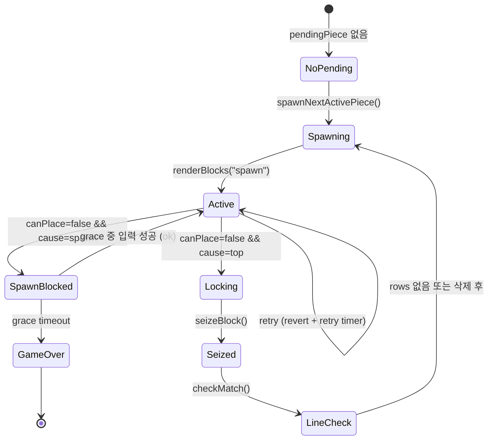

# Tetris Flow Notes

## 0) 용어/변수 사전 (Glossary)

### gameState 핵심 필드
- `board`: 보드 2D 배열(고정된 블록들). “현재까지 쌓인 상태”.
- `activePiece`: 현재 조작 중인 조각(확정된 위치)
  - 예: `{ pieceType, rotation, row, col }`
- `pendingPiece`: 이번 입력/중력으로 “가려고 시도하는” 조각
  - active에서 row/col/rotation을 바꾼 “후보” 상태
- `pieceQueue`: 앞으로 나올 조각 타입 큐
  - `shift()`로 다음 조각 꺼내고, `push(random)`로 보충
- `holdPieceType`: 홀드에 저장된 조각 타입(없으면 `null`/`""` 등)
- `holdUsedThisDrop`: “이번 드랍 턴에서 홀드를 이미 썼는지” 플래그
  - `true`면 같은 조각이 고정되기 전까지 홀드 재사용 금지
- `fallTimer`: 중력 `setInterval` 핸들(있으면 중력 ON, 없으면 OFF)
- `spawnGraceTimer`: 스폰 충돌 유예 `setTimeout` 핸들(있으면 유예 중)
- `score`: 점수

---

### moveCause(=cause) 정의
`renderBlocks(moveCause)`에 전달되는 문자열. “왜 이번 이동/판정이 발생했는지”를 의미.
- `"spawn"`: 새 조각을 스폰한 직후, 스폰 위치가 유효한지 검사
- `"top"`: 중력/하강(ArrowDown 포함)으로 인해 더 내려가려다 막혀서 “락(lock) 판정”이 필요한 케이스
  - gravity tick 또는 ArrowDown → renderBlocks("top")
- `"horizontal"`: 좌/우 이동 입력으로 발생
- `"retry"`: 스폰 충돌 재확인에만 사용(현재 구현은 setTimeout 재호출 포함)

---

### attempt / resolveMoveAttempt 의미
- `resolveMoveAttempt(...)`는 “이번 시도(attempt)가 가능한지”를 판정하는 엔진 함수
- “attempt”는 보통 아래를 묶어서 말해:
  - 입력/중력으로 바뀐 후보 상태(pending)를
  - 현재 board 위에 둘 수 있는지(canPlace) 검사하고
  - 가능하면 commit, 불가능하면 revert/lock/gameOver/spawnBlocked로 “결과(status)”를 내는 과정

---

### status 정의 (resolveMoveAttempt 결과)
- `idle`: pendingPiece가 비어 있음 → 아무 처리 없음
- `ok`: pending이 유효 → commit
- `retry`: pending이 불가 → revert만 하고 끝(대부분 “입력 무시”와 동일)
- `lock`: 하강 시도 실패(더 내려갈 수 없음) → 고정(seizeBlock)로 이동
- `spawnBlocked`: 스폰 위치부터 불가 → 유예(grace) 후 gameOver 또는 유예 중 탈출 성공 시 계속
- `gameOver`: 더 이상 진행 불가(유예 끝, 또는 상단 침범 고정 등) → 종료

---

1) “한 장” Flow (변수 변화 포함)

# Tetris Flow (Detailed, Current)

## A. 전체 플로우 (필드 변화까지 포함)

## B. 시퀀스 (실제 호출 순서 + 필드 변화 포인트)

## C. 상태 전이 (cause와 status 중심)

## 2) 함수별 정의 (무엇을 읽고/쓰는지)

### `shiftActivePiece(dr, dc)`
- 의미: “activePiece 기반으로 이동 후보(pendingPiece)를 만든다”
- 읽기: `gameState.activePiece`
- 쓰기: `gameState.pendingPiece` (row/col 변경)
- 다음: `renderBlocks(cause)` 호출

### `changeDirection()`
- 의미: 회전 후보(pendingPiece.rotation)를 만든다
- 읽기: `activePiece`
- 쓰기: `pendingPiece.rotation`
- 다음: `renderBlocks()` (cause 없음)

### `renderBlocks(moveCause)`
- 의미: “pending이 실제로 가능한지”를 엔진에 물어보고(status), 그 결과에 따라 state 변경/렌더/타이머 제어
- 읽기: `board, activePiece, pendingPiece`
- 쓰기: `activePiece/pendingPiece`, `fallTimer`, `spawnGraceTimer`, `UI(renderBoard)`
- 핵심: **상태를 바꾸는 게 여기서 최종 결정됨**

### `resolveMoveAttempt(board, active, pending, cause)`
- 의미: “이번 attempt가 가능한가?”
- 하는 일:
  - `canPlace(pending, board)` 검사
  - 불가면 `cause`에 따라 `spawnBlocked/lock/retry/gameOver` 판정
  - 가능하면 `ok(commit)`
- 반환: `{ status, active: commitOrRevert, pending: normalized }` 같은 형태

### `seizeBlock()`
- 의미: 더 내려갈 수 없으면 “activePiece를 board에 박아서 고정”
- 읽기: `activePiece, board`
- 쓰기: `board`(고정 반영), `activePiece=empty`, `holdUsedThisDrop=false`
- 추가: `touchesAboveTop`면 즉시 gameOver

### `checkMatch()`
- 의미: 꽉 찬 줄 찾고, 있으면 이펙트 후 삭제/점수/스폰
- 읽기: `board`
- 쓰기: `board`(줄 삭제), `score`
- 타이머: `350ms` 연출 동안 중력 멈춤/재개 관리
  - 실제 구현은 `findFullRows`로 이펙트 줄 찾은 뒤 `clearFilledLines`에서 다시 스캔

### `spawnNextActivePiece()`
- (현재 이름은 `generateNewBlock()`)
- 의미: 큐에서 다음 조각 뽑아 스폰하고 프리뷰 갱신
- 읽기/쓰기: `pieceQueue`
- 쓰기: `activePiece`, `pendingPiece`
- 다음: `renderBlocks('spawn')`로 스폰 유효성 검사

### `holdCurrentPiece()`
- (현재 이름은 `holdPiece()`)
- 의미: 현재 조각을 hold로 보내거나, hold와 swap
- 조건: `holdUsedThisDrop==true`면 무시
- 쓰기: `holdPieceType`, `activePiece`, `pendingPiece`, `holdUsedThisDrop=true`
- 타이머: hold 순간 중력 멈추고 스폰 검사 후 재개

---

## 3) “유예시간(Spawn Grace)”이 실제로 의미하는 것

- `spawnBlocked`가 뜨는 조건: **스폰 직후 위치가 이미 불가능**
- 목적: 즉사 방지(“유저가 0.4초 안에 회전/이동/홀드/하드드롭으로 빠져나가면 살림”)
- 핵심 포인트:
  - 유예 동안은 `fallTimer`를 멈춰서 **시간을 벌어줌**
  - 유예 타이머가 끝나도 여전히 못 빠져나오면 `gameOver`

---

원하면 다음도 바로 해줄게(질문 없이 내가 알아서 맞춰서):
1) 네 코드에서 쓰는 **실제 moveCause 문자열/필드명**에 1:1로 맞춘 버전  
2) `resolveMoveAttempt`의 “cause별 분기표(표 형태)”  
3) “유예 중 허용되는 입력만 통과시키는 방식(예: hold/rotate만 허용)” 설계안
